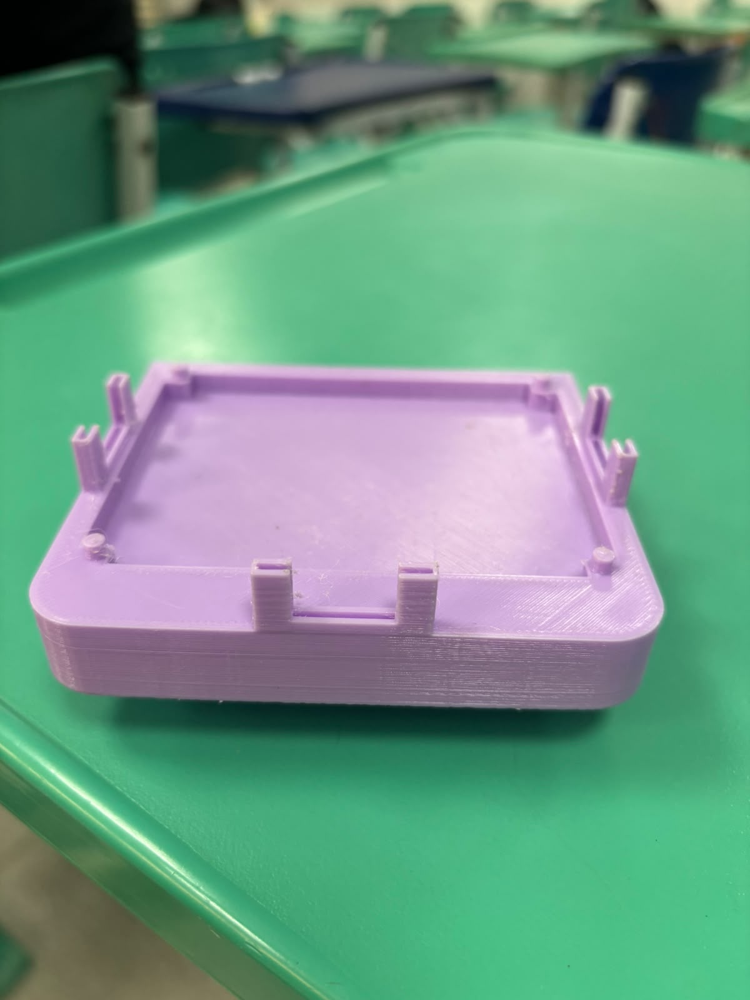
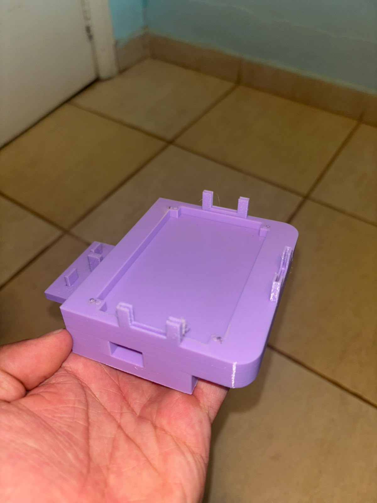
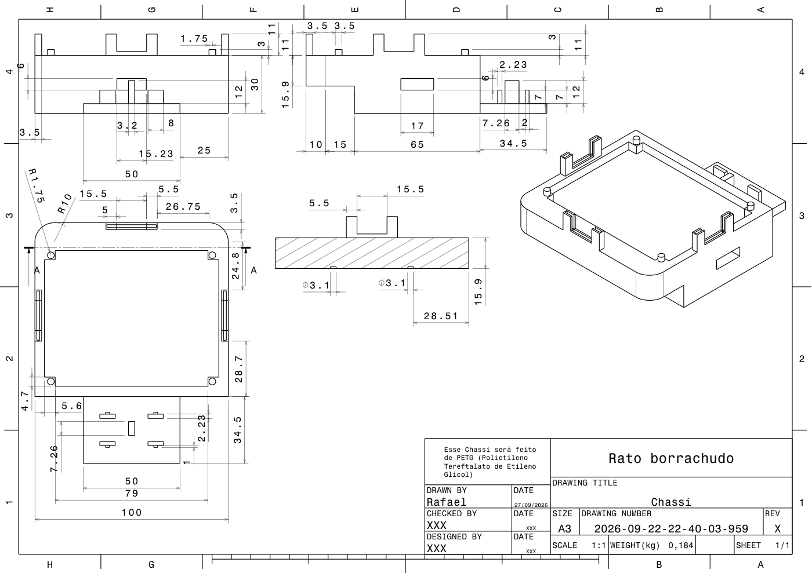
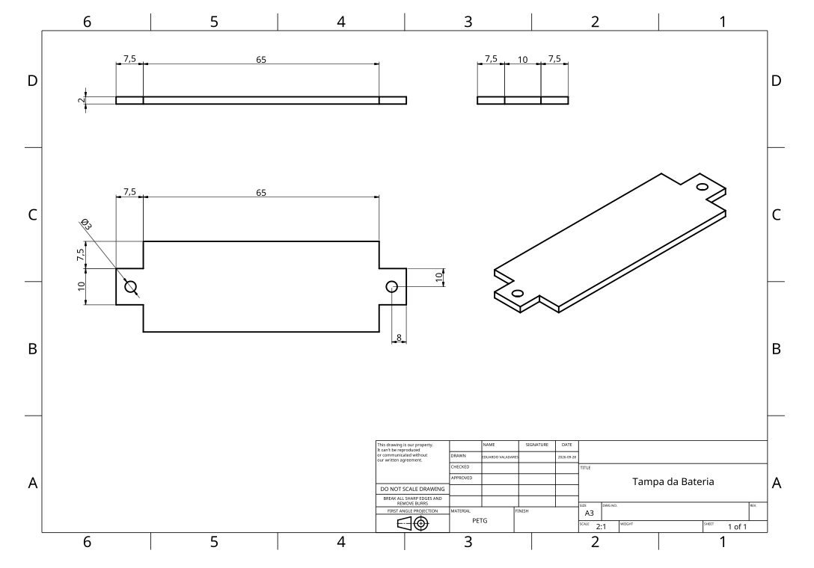
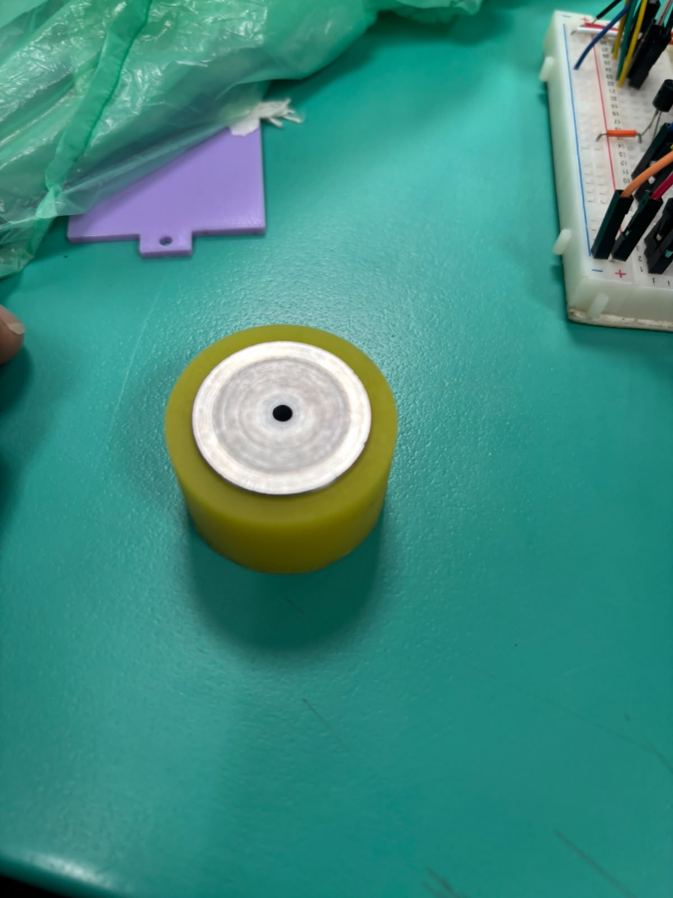
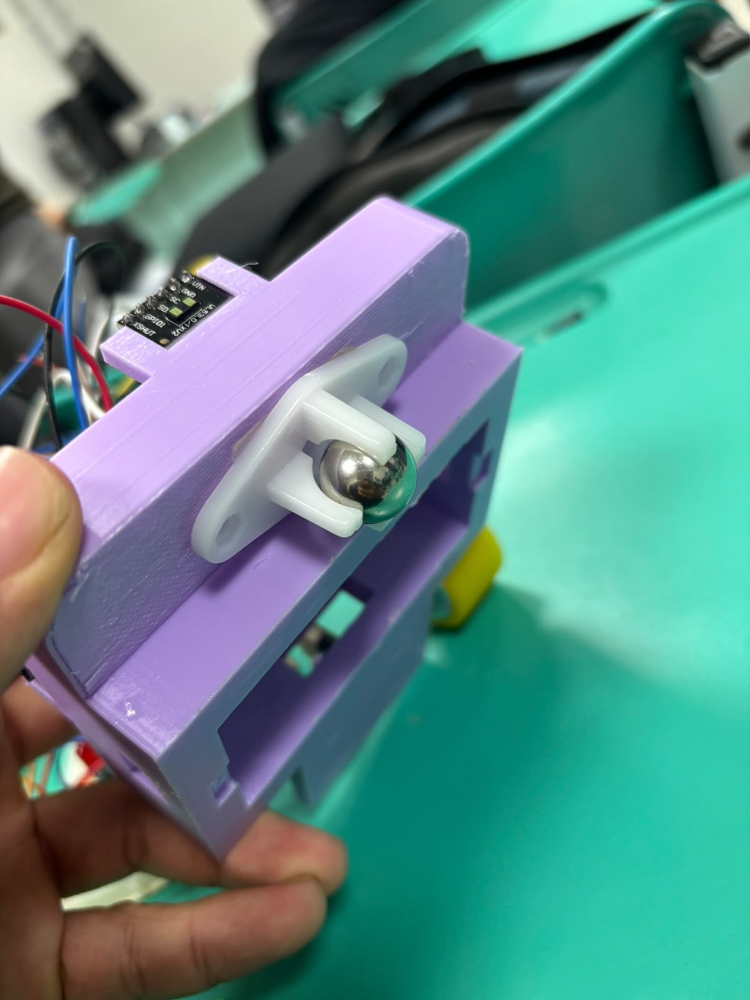
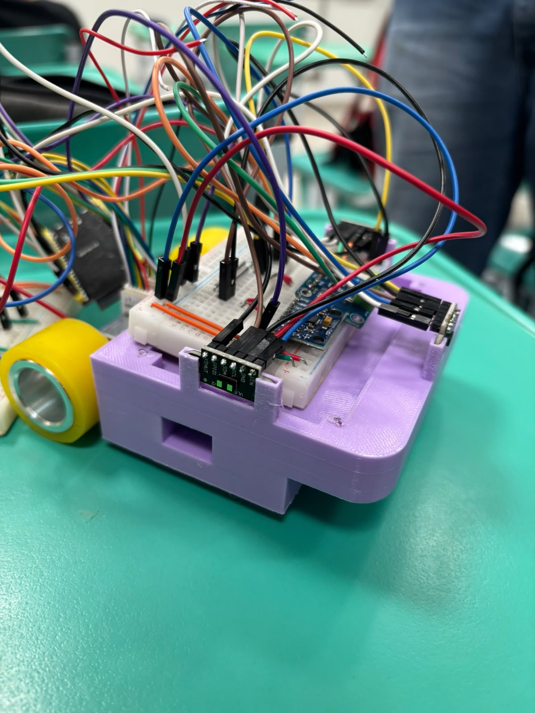
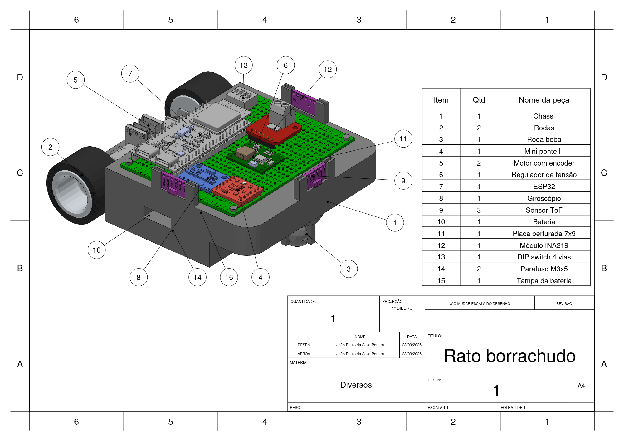
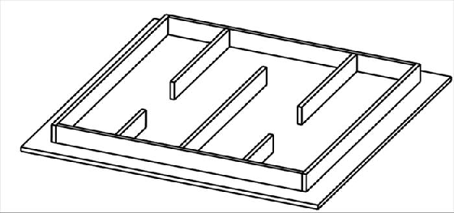
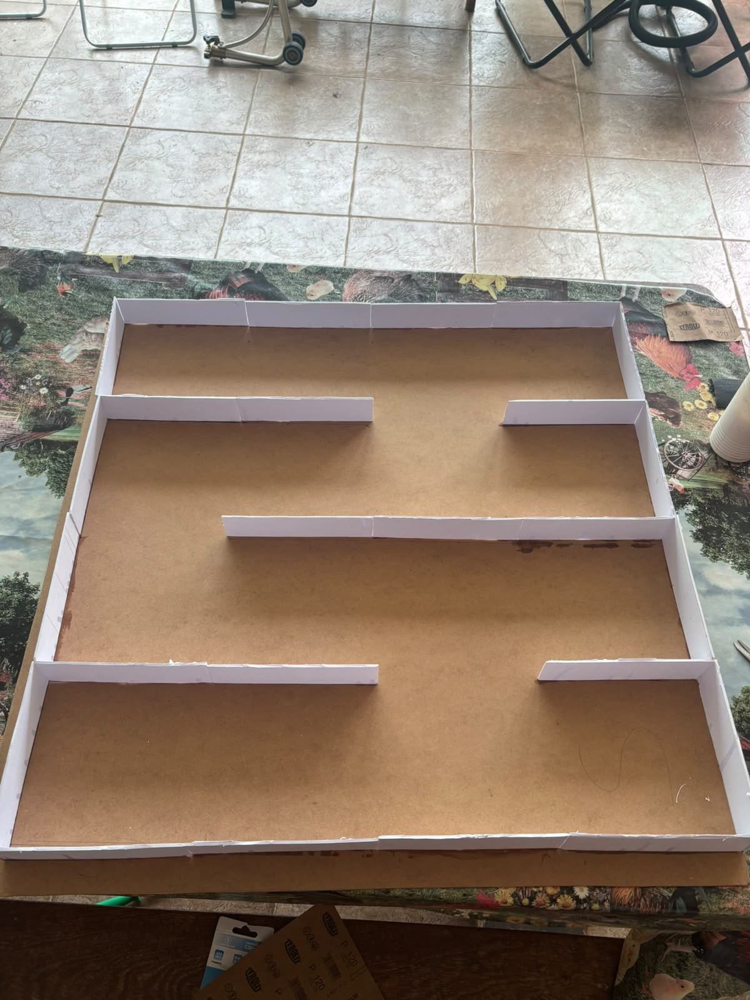

# Testes de Estrutura

Rato Borrachudo • PI1 2026/2 • Estruturas

Este documento apresenta os testes realizados para verificar se a estrutura do Rato Borrachudo atende aos requisitos definidos para a frente de Estruturas (RF01 a RF04 e RNF01 a RNF05). Também registra as alterações feitas entre a primeira e a segunda versão do chassi e a divergência encontrada entre o CAD do labirinto de testes e o labirinto construído.

---

## 1 Evolução do chassi: da versão 1 para a versão 2

A primeira versão impressa do chassi foi montada e avaliada. A partir dessa avaliação, as seguintes alterações foram incorporadas na segunda versão:

| Item | Versão 1 | Versão 2 | Objetivo da alteração |
| :---- | :---- | :---- | :---- |
| Furo de passagem do fio da bateria | 12 × 8 mm | Aumentado para 16 × 10 mm | Permitir a passagem do fio e do conector da bateria para a parte superior do chassi sem forçar os cabos. |
| Distância entre a roda e o chassi | 0,5 mm | Aumentada para 1,25 mm | Garantir que as rodas girem livremente, sem contato com a lateral do chassi. |
| Fixação da placa perfurada | Encaixe integrado ao chassi | Encaixe removido; fixação por parafusos | Fixar a placa perfurada com mais firmeza e permitir sua remoção para manutenção. |
| Furos para os enforca-gatos dos motores | 1 × 2 mm | Aumentados para 3 × 8 mm | Facilitar a passagem dos enforca-gatos que prendem os motores ao chassi. |
| Tampa da bateria | Dimensões originais | Reduzida em 1 mm em todas as dimensões | Fazer a tampa encaixar certinho no compartimento da bateria. |
| Dimensões gerais do robô | 100 × 135 mm | Reduzidas para 100 × 120 mm | Garantir que o robô caiba no labirinto com folga para se deslocar e manobrar. |

 

*Figura 1 \- Chassi versão 1 (esquerda) e versão 2 (direita). Fonte: autoria própria.*

---

## 2 Registro visual da estrutura

### 2.1 Peças separadas

 

*Figura 2 \- Peças da estrutura do Rato Borrachudo separadas: chassi (esquerda) e tampa da bateria (direita), em desenho técnico. O desenho do chassi é de 27/09/2026, anterior às alterações da versão 2 (seção 1). Fonte: [mec/Desenhos/chassi.pdf](../mec/Desenhos/chassi.pdf) e [mec/Desenhos/tampa_bateria.pdf](../mec/Desenhos/tampa_bateria.pdf).*

### 2.2 Componentes individuais

*Figura 3 \- Chassi (versão 2). Fonte: autoria própria.*

*Figura 4 \- Tampa da bateria, em desenho técnico. Fonte: [mec/Desenhos/tampa_bateria.pdf](../mec/Desenhos/tampa_bateria.pdf).*

 

*Figura 5 \- Roda de tração (esquerda) e roda boba (direita). Fonte: autoria própria.*

### 2.3 Estrutura montada

*Figura 6 \- Estrutura do Rato Borrachudo montada. Fonte: autoria própria.*

### 2.4 Montagem virtual em CAD com todos os componentes

  
*Figura 7 \- Montagem virtual do Rato Borrachudo em CAD com todos os componentes, usada para verificar se as peças foram construídas e montadas em conformidade com o projeto. Fonte: mec/Desenhos/assembly.pdf.*

---

## 3 Labirinto de testes

O labirinto de testes 4×4 foi construído conforme o requisito RF04, com células de 18 cm de lado e paredes de 5 cm de altura. Durante a construção, houve uma divergência entre o CAD do labirinto e o que foi construído: as paredes ficaram com 6 mm de espessura, metade dos 1,2 cm previstos no projeto (RNF04).

| Parâmetro | Valor no CAD | Valor construído | Diferença |
| :---- | :---- | :---- | :---- |
| Espessura das paredes | 12 mm | 6 mm | 6 mm |
| Altura das paredes | 50 mm | 50 mm | 0 mm |
| Lado da célula | 180 mm | 180 mm | 0 mm |
| Dimensões totais | 720 × 720 mm | 720 × 720 mm | 0 mm |

 

Com paredes mais finas, os corredores do labirinto de testes ficam 6 mm mais largos que os do labirinto oficial. Por isso, as folgas medidas no labirinto de testes devem ser consideradas maiores que as que o robô encontrará no desafio, e a verificação de dimensões do robô deve considerar a espessura de parede oficial de 1,2 cm.

*Figura 8 \- CAD do labirinto de testes. Fonte: autoria própria.*

*Figura 9 \- Labirinto de testes construído. Fonte: autoria própria.*

---

## 4 Tabela de testes

| ID | Descrição | Data de Início | Data de Conclusão | Responsável | Resultados Esperados | Resultados Obtidos | Aprovação Interna (S/N) | Aprovação do Orientador (S/N) | Observações |
| :---- | :---- | :---- | :---- | :---- | :---- | :---- | :---- | :---- | :---- |
| 1.1 | Medição das dimensões do robô montado (RNF03) | 26/10/2026 | 26/10/2026 | @gabrielcs-aero | Comprimento e largura de até 16,5 cm cada. | Dimensões reduzidas na versão 2 para 120 × 100 mm. | S |   |   |
| 1.2 | Passagem do fio da bateria pelo chassi (RF01) | 26/10/2026 | 26/10/2026 | @spycidymaligno | Fio e conector passam para a parte superior sem forçar os cabos. | Furo ampliado na versão 2 para 16 × 10 mm. | S |   | Alteração da v1 para a v2. |
| 1.3 | Folga entre as rodas e o chassi (RF02) | 26/10/2026 | 26/10/2026 | @Jp-te | Rodas giram livremente, sem contato com o chassi. | Distância aumentada na versão 2 para 1,25 mm. | S |   | Alteração da v1 para a v2. |
| 1.4 | Fixação da placa perfurada por parafusos (RF01, RNF01) | 20/10/2026 | 26/10/2026 | @spycidymaligno | Placa firme, sem folga, e removível para manutenção. | Encaixe substituído por parafusos na versão 2\.  | S |   | Alteração da v1 para a v2. |
| 1.5 | Fixação dos motores com enforca-gatos (RF01, RNF01) | 20/10/2026 | 26/10/2026 | @gabrielcs-aero | Enforca-gatos passam pelos furos e os motores ficam fixos nas guias. | Furos ampliados na versão 2 para 3 × 8 mm. | S |   | Alteração da v1 para a v2. |
| 1.6 | Montagem da tampa e acesso à bateria (RF03) | 24/10/2026 | 26/10/2026 | @gabrielcs-aero | Tampa encaixa no compartimento, segura a bateria e permite removê-la com facilidade. | Tampa reduzida em 1 mm em todas as dimensões na versão 2\. Encaixa no compartimento, porém com a bateria não encaixa perfeitamente. | N |   | Alteração da v1 para a v2. |
| 1.7 | Estabilidade em repouso (RNF02) | 26/10/2026 | 26/10/2026 | @EduOValadares | Apenas os elementos de rodagem tocam o piso, sem tombamento. | Apenas as rodas e a roda boba tocam o chão e o robô permanece estável. | S |   |   |
| 1.8 | Conferência do labirinto construído com o CAD (RF04, RNF04) | 19/10/2026 | 19/10/2026 | @spycidymaligno | Labirinto 4×4 com células de 18 cm e paredes de 5 cm de altura e 1,2 cm de espessura. | Paredes construídas mais finas que o previsto: 6 mm. | S |   | Ver seção 3\. |
| 1.9 | Determinação do centro de gravidade do robô | 26/10/2026 | 26/10/2026 | @Jp-te | Centro de gravidade próximo ao centro geométrico da placa, sem deslocamento relevante causado pelas paredes. | CG em X \= 46 mm, Y \= 0.7 mm e Z \= 17  mm, a partir do bordo de fuga |  S |   | Calculado pelo Fusion automaticamente dado as densidades dos materiais e componentes. |
