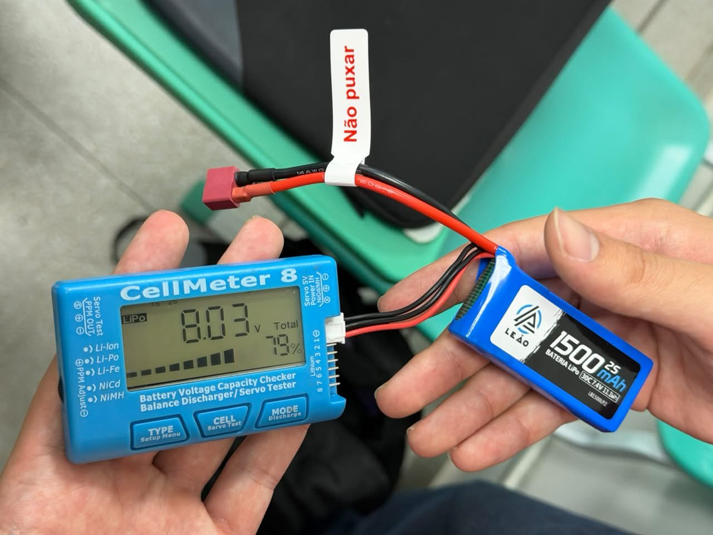
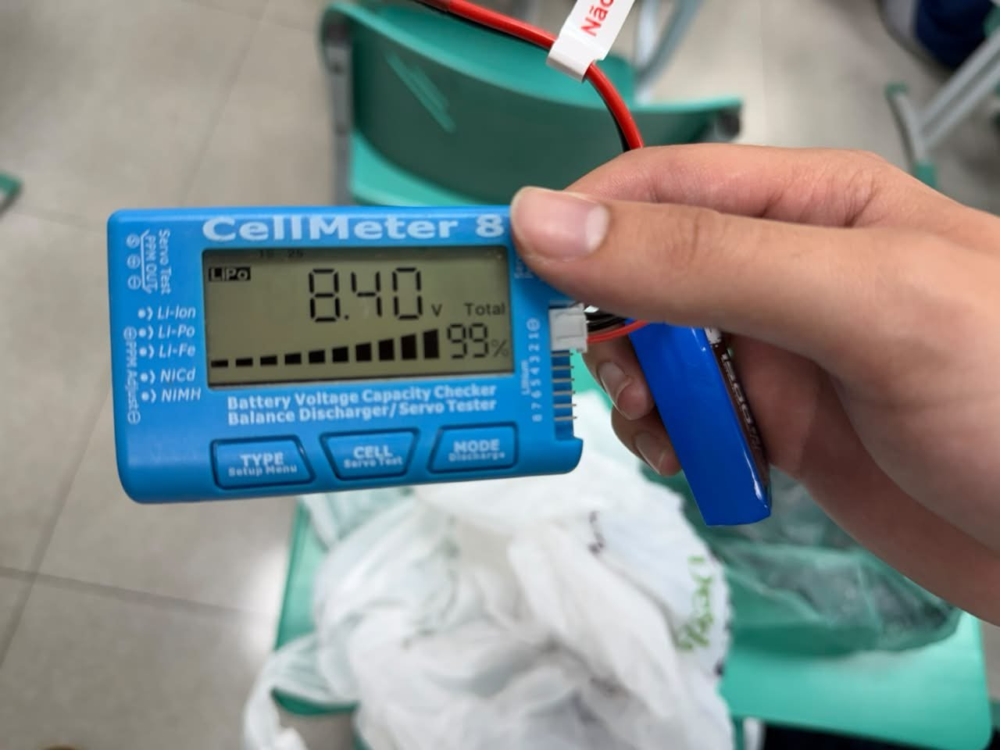
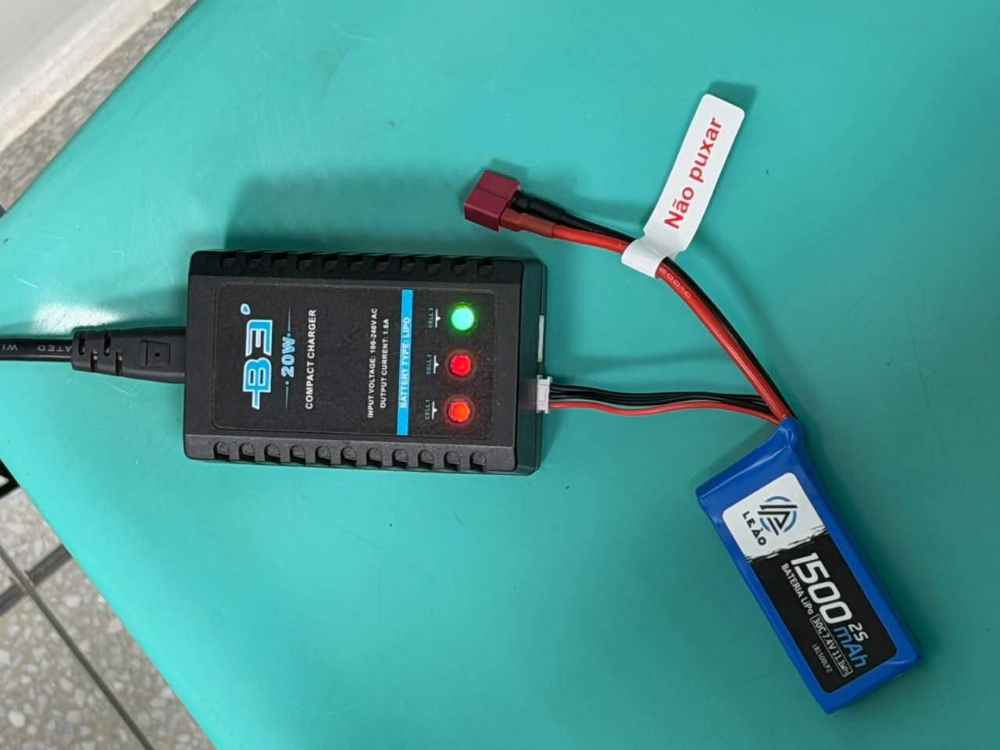
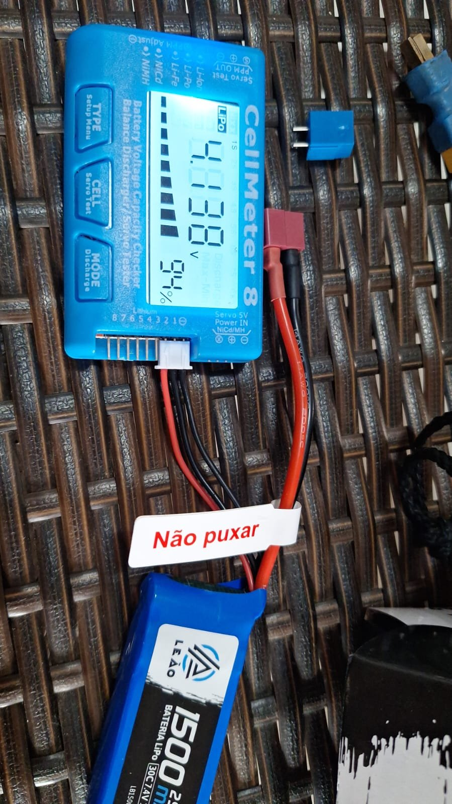
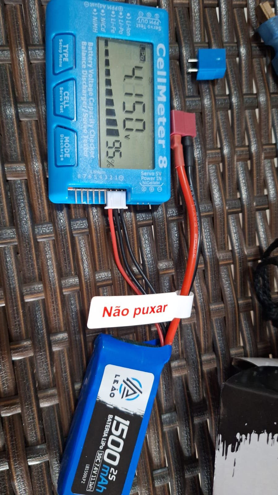

# Testes de Energia

>Apresentar com detalhes os testes feitos para conferir se as demandas energéticas do projeto foram atendidas.

| **ID** | **Descrição** | **Data de Início** | **Data de Conclusão** | **Responsável** | **Resultados Esperados** | **Resultados Obtidos** | **Aprovação Interna (S/N)** | **Aprovação do Orientador (S/N)** | **Observações** |
|:------:|---------------|--------------------|-----------------------|-----------------|--------------------------|------------------------|:---------------------------:|:--------------------------------:|-----------------|
| 2.1 | Monitoramento da bateria com o CellMeter 8 (tensão total e porcentagem), antes e depois da carga. Cobre RNF23 e RNF24 (issue #401). | 22/10/2026 | 22/10/2026 | Thiago e Kaleb | Bateria LiPo 2S de 7,4 V reconhecida pelo CellMeter, com tensão entre 6,4 V e 8,4 V e taxa de descarga de 30C. | 8,03 V (79%) antes da carga e 8,40 V (99%) depois. Bateria LiPo Leão 1500 mAh, 2S, 7,4 V, 30C. O CellMeter monitora tensão e porcentagem corretamente. | S | S | RNF24 conferido pela etiqueta da bateria, sem medição de descarga. |
| 2.2 | Carga da bateria pelo conector JST-XH com o carregador balanceador B3 20W (IMAX), com o cabo de potência desconectado, e conferência da tensão por célula no CellMeter. Cobre RF26, RNF28 e RNF29 (issue #402). | 22/10/2026 | 22/10/2026 | Thiago e Kaleb | Carga completa somente pelo JST-XH e células balanceadas em cerca de 4,20 V. | Carga de 79% a 99% (8,03 V a 8,40 V). Células em ≈4,15 V e ≈4,09 V, balanceadas. O carregador carrega e balanceia a bateria. | S | S | Carga feita sem usar a saída de potência. |
| 2.3 | Verificação do armazenamento seguro da bateria. Cobre RNF30 (issue #403). | | | Thiago e Kaleb | Bateria mantida segura dentro da embalagem original, devidamente fechada. | Bateria mantida na embalagem original (caixa de papelão com espuma e plástico bolha), fechada corretamente e segura. | S | S | A embalagem já acompanha a bateria. |
| 2.4 | | | | | | | | | |
| 2.5 | | | | | | | | | |
| 2.6 | | | | | | | | | |
| 2.7 | | | | | | | | | |
| 2.8 | | | | | | | | | |
| 2.9 | | | | | | | | | |
| 2.10 | | | | | | | | | |
| 2.12 | | | | | | | | | |
| 2.13 | | | | | | | | | |
| 2.15 | | | | | | | | | |
| 2.16 | | | | | | | | | |

## Evidências

### 2.1 - Monitoramento da bateria (CellMeter)

### 2.2 - Carga e balanceamento pelo JST-XH

