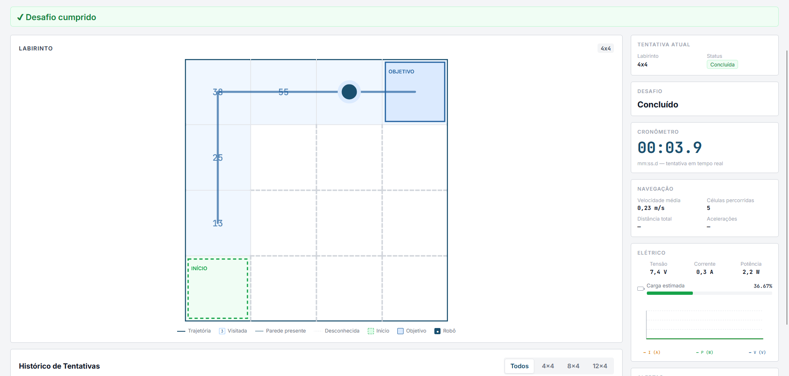
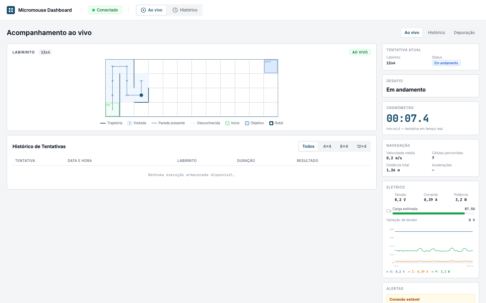
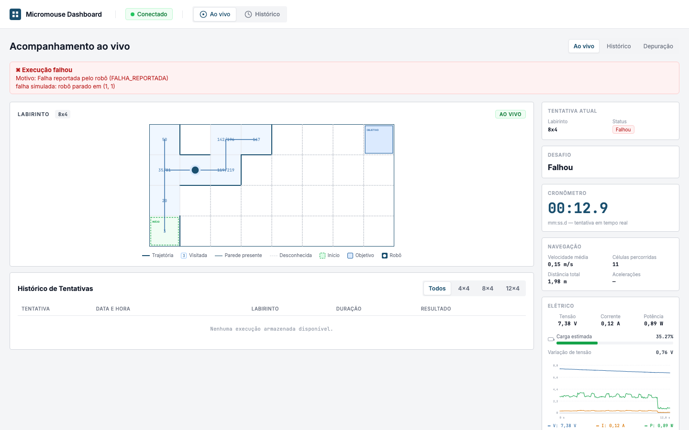
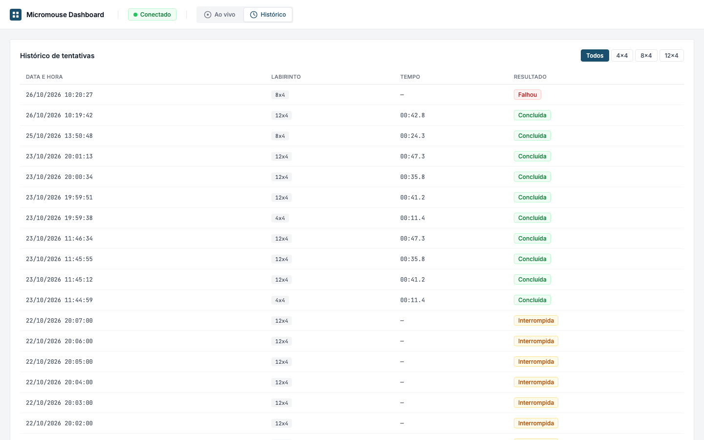
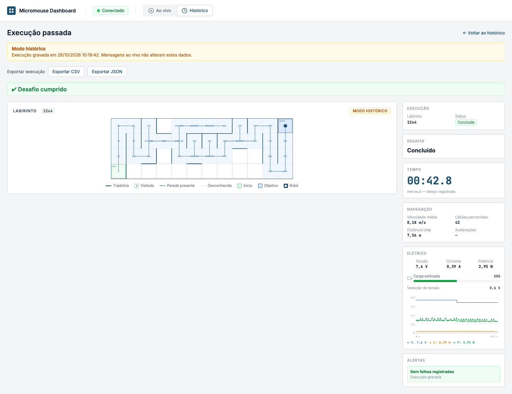

# Testes de Software
## Testes de _software_

Este documento reúne os testes de _software_ do projeto Rato Borrachudo, por frente. Cada seção segue o que o roteiro da disciplina pede: as histórias de usuário implementadas, a associação delas com os casos de teste, a evidência das suítes automatizadas (unitário e integração, com cobertura de código de pelo menos 80%) e o teste de sistema.

| Frente | Situação desta seção |
|:--|:--|
| [Firmware](#firmware) | preenchida |
| [Backend](#backend) | preenchida |
| [Frontend](#frontend) | preenchida |

> **Estado de referência:** os números abaixo são da branch `software-dev` (a branch oficial de integração): os do Firmware em **24/10/2026**, e os do Backend e o CI e a cobertura do Frontend em **25/10/2026** (`c43fe15`), e o E2E e o teste de sistema do Frontend em **26/10/2026**. Os resultados em hardware são de **21 a 23/10/2026**. Os PRs [#396](https://github.com/fcte-pi1/2026.2_PI1_Grupo1_Diogo/pull/396) e [#397](https://github.com/fcte-pi1/2026.2_PI1_Grupo1_Diogo/pull/397) já foram **mesclados** na `software-dev` (testes de host e builds verdes), mas as correções que eles trazem **ainda não foram confirmadas na placa**: o que depende disso está marcado como **pendente** ou **parcial**, até o teste de 26/10.

---

## Firmware

### 1. Escopo, níveis de teste e ambientes

O firmware cobre os requisitos funcionais **RF-27 a RF-56** (30 histórias de usuário, HU-01 a HU-30) e os requisitos não funcionais **RNF-32 a RNF-35**. Os 34 casos de teste planejados (`CT-FW-01` a `CT-FW-34`) estão em [`docs/projeto-conceitual-software/firmware/testes.md`](projeto-conceitual-software/firmware/testes.md) e no `4.4`.

O firmware é C++17, em arquitetura limpa: o **núcleo** (domínio, casos de uso, protocolo e telemetria) não conhece hardware e é testado no PC; os **adaptadores** (sensores, motores, BLE) só compilam no ESP-IDF e são exercitados na placa.

| Nível | O que testa | Ferramenta | Onde roda | Resultado |
|:--|:--|:--|:--|:--|
| Unitário e de lógica | Núcleo no PC: mapa, Flood Fill, navegação, máquina de estados, PID, odometria, protocolo, telemetria | GoogleTest 1.17 + CTest + gcovr | CI (`Build, test and coverage`) e local | **104 de 104**, cobertura de linhas **93,0%** |
| Integração firmware ↔ backend | Cada mensagem que o `Encoder` real do firmware gera é validada contra os esquemas JSON do backend | Vitest | CI (`Contrato firmware ↔ backend`) | **26 de 26** |
| Compilação para a placa | Robô e firmware de diagnóstico, nos dois alvos (S3 e ESP32 clássica) | ESP-IDF 5.3.3 | CI (`Placa`, 4 combinações) | **4 de 4** |
| Hardware | Cada componente na placa, com o firmware de diagnóstico | console serial `rato>` | bancada | ver seção 7 |
| Sistema (E2E) | Placa → BLE → ponte → backend → banco → painel | placa real, ponte BLE, Docker | bancada | ver seção 8 |

**Ambientes.**
- **ESP32-S3-DevKitC-1 N16R8** (a placa oficial: 16 MB de flash, 8 MB de PSRAM) e **ESP-WROOM-32** emprestada (bancada).
- Ponte BLE em Python 3.12 (`src/firmware/bridge/`), no notebook (Windows 11, Bluetooth integrado).
- Backend, PostgreSQL e painel em Docker (`docker compose`).

> **Limite do que foi testado.** O robô **ainda não foi montado**: não há ponte H nem conversor, e o driver dos sensores de distância (VL53L1X) ainda é um _stub_. Por isso **nenhum teste de navegação real foi feito na pista 4×4**. A telemetria e a lógica de navegação foram validadas, mas a corrida física não.

### 2. Histórias de usuário e protótipos

As 30 histórias do firmware estão em [`docs/projeto-conceitual-software/firmware/backlog.md`](projeto-conceitual-software/firmware/backlog.md), uma por requisito (HU-*n* = RF-(26+*n*) = CT-FW-*n*). O beneficiário é o **operador**: quem prepara, dispara e acompanha o robô.

**Protótipos de interface: não se aplica.** O firmware **não possui tela**; a interação com o operador é física: botão de largada, chave DIP de 3 vias, dois LEDs e buzzer. O dado que o firmware produz aparece no **painel ao vivo** (protótipo e testes na seção do Frontend); a figura da seção 8 mostra uma corrida do firmware nesse painel.

### 3. Rastreabilidade: história, requisito, caso de teste e evidência

**Legenda da situação:**
**Atendido** (testado e passando), **Parcial** (parte testada, parte pendente), **Pendente** (depende de confirmação na placa ou de hardware ainda não disponível), **Não implementado**, **Substituído** (requisito trocado por decisão da equipe).
"Host" = teste automatizado no PC (`Suíte.Teste`). "HW" = teste na placa.

| HU | RF | Caso | Situação | Evidência |
|:--|:--|:--|:--|:--|
| HU-01 Auto-teste ao boot | RF-27 | CT-FW-01 | Parcial | Host: `SessionManager.SelfTestOkGoesToExploringAndSignalsReady`, `SelfTestFailureGoesToFaultAndSignalsError`. HW: boot da S3 com PSRAM e BLE (seção 8). O auto-teste cobre IMU e INA219; a verificação do próprio ESP32 e dos GPIO se resume ao log do ESP-IDF |
| HU-02 Reendereçamento dos ToF | RF-28 | CT-FW-02 | Não implementado | O driver VL53L1X é _stub_ (`src/adapters/Vl53l1xSensorAdapter.cpp`), [#312](https://github.com/fcte-pi1/2026.2_PI1_Grupo1_Diogo/issues/312). HW: `tof xshut` confirma a fiação dos 3 XSHUT. O teste de bancada do hardware (TESTE-HW-01) validou os endereços `0x30`, `0x31` e `0x32` com biblioteca Arduino. O caso e a HU falam em **sete** sensores; o projeto de hardware (`4.3`) usa **três** |
| HU-03 IMU e INA219 respondem | RF-29 | CT-FW-03 | Parcial | HW (`verificar`): INA219 `[ OK ]`; MPU-6050 `[FALHA]` com `WHO_AM_I = 0x72`. Corrigido no [#396](https://github.com/fcte-pi1/2026.2_PI1_Grupo1_Diogo/pull/396) (mesclado, falta confirmar na placa), 8 testes novos |
| HU-04 DIP e tipo de labirinto | RF-30 | CT-FW-04 | Parcial | Host: `DipDecoder.*` (6 testes). HW (S3): vias soltas = 4×4 pela esquerda, correto. O caso da via 3 não passou por problema de fiação (seção 8). Modos 8×4, 12×4 e a combinação proibida: pendentes |
| HU-05 Inicializa o mapa | RF-31 | CT-FW-05 | Atendido | Host: `MazeMap.*` (6 testes), `Navigator.InitializesPoseAndGoal` |
| HU-06 Sinaliza prontidão | RF-32 | CT-FW-06 | Parcial | Host: `SessionManager.SelfTestOkGoesToExploringAndSignalsReady`. O buzzer da bancada foi validado com biblioteca Arduino (TESTE-HW-08); o do firmware está no [#397](https://github.com/fcte-pi1/2026.2_PI1_Grupo1_Diogo/pull/397) (mesclado, falta confirmar na placa) |
| HU-07 Lê os ToF periodicamente | RF-33 | CT-FW-07 | Não implementado | Driver _stub_ ([#312](https://github.com/fcte-pi1/2026.2_PI1_Grupo1_Diogo/issues/312)) |
| HU-08 Classifica paredes por limiar | RF-34 | CT-FW-08 | Parcial | Host: `Navigator.StepRecordsSensedWalls` (com sensor simulado). O limiar de 90 mm no adaptador depende do driver |
| HU-09 Lê o IMU | RF-35 | CT-FW-09 | Atendido | HW (`imu 3`): giro Z lido, desvio parado −0,196 °/s. Rotação de 90° com transferidor: −90,89° (TESTE-HW-03). Host: `Maneuver.Gyro*` (7 testes) |
| HU-10 Lê a energia do INA219 | RF-36 | CT-FW-10 | Parcial | HW: `ina 5` lê tensão e corrente. TESTE-HW-04: 3,312 V contra 3,26 V no multímetro (1,59%). Faltam a faixa real (6 a 8,4 V) e corrente com carga |
| HU-11 Atualiza o mapa | RF-37 | CT-FW-11 | Atendido | Host: `MazeMap.SetWallIsConsistentOnBothSides`, `Navigator.StepRecordsSensedWalls` |
| HU-12 Propaga a inundação | RF-38 | CT-FW-12 | Atendido | Host: `FloodFill.GoalHasDistanceZero`, `PropagatesOneStepToNeighbor`, `OpenMazeGivesManhattanDistance`, `WallDivertsThePath` |
| HU-13 Escolhe a próxima célula | RF-39 | CT-FW-13 | Atendido | Host: `FloodFill.NextDirectionChoosesSmallestWithTieBreak`, `Navigator.MovesStraightWithoutTurningWhenAligned`, `TurnsWhenNeedsToChangeDirection` |
| HU-14 Recalcula a rota | RF-40 | CT-FW-14 | Atendido | Host: `FloodFill.RecomputeResetsStaleValues`, `Navigator.ReroutesWhenDiscoveringWall` |
| HU-15 Encerra o mapeamento | RF-41 | CT-FW-15 | Atendido | Host: `Navigator.ReachesGoalInOpenMaze`, `SessionManager.ReachedGoalDuringExplorationGoesToReturning` |
| HU-16 PWM via LEDC | RF-42 | CT-FW-16 | Pendente | Compila no CI (job `Placa`). Sem teste: depende da ponte H, que ainda não chegou |
| HU-17 PID de velocidades | RF-43 | CT-FW-17 | Parcial | Host: `Pid.*` (3), `PidTest.*` (2), `MotionController.*` (3). A malha fechada com motores depende da ponte H |
| HU-18 Correção por ToF e IMU | RF-44 | CT-FW-18 | Parcial | Só a correção por diferença dos encoders existe (`MotionController`). ToF e IMU não participam da correção em linha reta |
| HU-19 Ângulo de curva | RF-45 | CT-FW-19 | Parcial | Host: `Maneuver.*` (10). Escala do giro validada em bancada (−90,89° para −90°). A curva com os motores depende da ponte H |
| HU-20 Avança só após a curva | RF-46 | CT-FW-20 | Parcial | Host: `Navigator.TurnsWhenNeedsToChangeDirection`. No hardware, depende dos motores |
| HU-21 Pulsos dos encoders | RF-47 | CT-FW-21 | Pendente | O firmware usa o contador de pulsos em hardware (PCNT). Pull-up e sentido no [#396](https://github.com/fcte-pi1/2026.2_PI1_Grupo1_Diogo/pull/396); teste com o `enc` na placa na próxima rodada |
| HU-22 Pulsos em distância | RF-48 | CT-FW-22 | Atendido | Host: `Odometry.OneTurnTravelsOneCircumference`, `PulsesAccumulateAndScale`, `ReversesWithNegativePulses`. Os parâmetros físicos (pulsos por volta, diâmetro) ainda precisam de medição |
| HU-23 Conta as células | RF-49 | CT-FW-23 | Atendido | Host: `Odometry.CountsCellsWithFloorDivision`. E2E: 5 transições registradas e exibidas no painel (seção 8) |
| HU-24 Velocidade média | RF-50 | CT-FW-24 | Parcial | Host: `Odometry.AverageSpeedGuardsAgainstDivisionByZero`. O firmware **não transmite** a velocidade (`ProtocolV1.PosicaoSemVelocidadeOmiteOCampo`): o backend a calcula (0,231 m/s na corrida da seção 8) |
| HU-25 Wi-Fi em modo estação | RF-51 | CT-FW-25 | Substituído | O transporte passou a **BLE** por decisão da equipe (`4.3`, §4.2). Não será testado |
| HU-26 Telemetria contínua | RF-52 | CT-FW-26 | Parcial | Host: `ProtocolV1.*` (13), `TelemetryEmitter.*` (7), `TelemetryBuffer.*` (7). Contrato: 26 casos. E2E funciona (seção 8), mas há perda de 4 a 6% das notificações BLE ([#381](https://github.com/fcte-pi1/2026.2_PI1_Grupo1_Diogo/issues/381), [#384](https://github.com/fcte-pi1/2026.2_PI1_Grupo1_Diogo/pull/384)) |
| HU-27 Transmissão unidirecional | RF-53 | CT-FW-27 | Atendido | Por projeto: a característica BLE só tem `NOTIFY` e a porta de telemetria só tem `publish`. Sem teste dedicado |
| HU-28 Máquina de estados | RF-54 | CT-FW-28 | Atendido | Host: `SessionManager.*` (8): `FullFlowUntilFinished`, `OutOfOrderEventsAreIgnored`, `StartGoesToSelfTest` |
| HU-29 Falha e estado Erro | RF-55 | CT-FW-29 | Parcial | Host: `SessionManager.SelfTestFailureGoesToFaultAndSignalsError`, `FaultInterruptsActivePhase`. HW: a falha do IMU apareceu no `verificar`. O alarme sonoro está no [#397](https://github.com/fcte-pi1/2026.2_PI1_Grupo1_Diogo/pull/397) (mesclado, falta confirmar na placa) |
| HU-30 Sessões consecutivas | RF-56 | CT-FW-30 | Parcial | E2E: reinícios seguidos geraram corridas independentes no banco (seção 8). Uma 2ª corrida **sem reiniciar** a placa não está implementada |
| — | RNF-33 | CT-FW-31 | Atendido | Por projeto: navegação e telemetria em tarefas separadas, ligadas por fila. Sem teste de carga |
| — | RNF-32 | CT-FW-32 | Atendido | Host: `FloodFill.NextDirectionChoosesSmallestWithTieBreak` |
| — | RNF-34 | CT-FW-33 | Atendido | Host: `Maneuver.DerivaNaoSeAcumulaEntreCurvasConsecutivas` (10 curvas com a deriva de −0,196 °/s medida no `imu 3`: o erro por curva se repete e não cresce, ao contrário da integração sem zerar). Cada curva usa um controlador novo, com a referência angular em zero |
| — | RNF-35 | CT-FW-34 | Pendente | Antes o DIP era lido depois do botão; a leitura só no boot foi feita no [#396](https://github.com/fcte-pi1/2026.2_PI1_Grupo1_Diogo/pull/396) (mesclado, falta confirmar na placa) |

**Resumo das 30 histórias:** 11 atendidas, 14 parciais, 2 pendentes, 2 não implementadas e 1 substituída. Dos 4 requisitos não funcionais: 3 atendidos e 1 pendente. Dos 11 "atendidos", dois (HU-27 e CT-FW-31) são por inspeção do projeto, sem teste automatizado.

### 4. Suíte automatizada: testes unitários e de lógica (host)

Os testes rodam no PC, sem placa. O CI os executa a cada mudança em `src/firmware/` e **reprova o build** se a cobertura de linhas ficar abaixo de **80%**.

| Arquivo | Testes | O que cobre |
|:--|:--:|:--|
| `domain/MazeTest.cpp` | 6 | dimensões, paredes e perímetro do mapa |
| `domain/FloodFillTest.cpp` | 6 | distâncias, desvio por parede, desempate, recálculo |
| `use_cases/NavigatorTest.cpp` | 6 | pose, paredes sentidas, giro, chegada ao objetivo, nova rota |
| `use_cases/SessionManagerTest.cpp` | 12 | máquina de estados, falha, eventos fora de ordem, sinal de objetivo |
| `domain/DipDecoderTest.cpp` | 6 | tipo de labirinto, canto de partida, combinação proibida |
| `domain/OdometryTest.cpp` | 8 | pulsos em distância, células, velocidade média |
| `domain/PidTest.cpp` | 5 | termos proporcional, integral e derivativo |
| `controller/MotionControllerTest.cpp` | 3 | correção diferencial e saturação |
| `domain/ManeuverTest.cpp` | 10 | pulsos de uma curva e integração do giroscópio |
| `protocol/ProtocolV1Test.cpp` | 13 | mensagens do protocolo, chaves por extenso, escape e truncamento do `detalhe` |
| `telemetry/TelemetryBufferTest.cpp` | 7 | retenção de 60 s e teto de contagem |
| `telemetry/TelemetryEmitterTest.cpp` | 7 | sequência, estado, posição, energia, fim de corrida |
| `domain/ImuIdentityTest.cpp` | 8 | classificação do `WHO_AM_I` do IMU (família 0x68, 0x70 a 0x73) |
| `domain/BuzzerPatternTest.cpp` | 7 | padrões sonoros: pronto, objetivo e alarme |
| **Total** | **104** | |

**Evidência: saída do CTest e do gcovr no CI** ([execução 40133246751](https://github.com/fcte-pi1/2026.2_PI1_Grupo1_Diogo/actions/runs/40133246751), job `Build, test and coverage`, na `software-dev`, após a mesclagem dos PRs #396 e #397):

```text
100% tests passed, 0 tests failed out of 104

Total Test time (real) = 0.43 sec

lines: 93.0% (519 out of 558)
functions: 98.1% (101 out of 103)
branches: 62.8% (367 out of 584)
```

A cobertura de **93,0% das linhas** atende ao mínimo de 80%. O relatório HTML por arquivo fica no artefato `coverage-report` da mesma execução, retido pelo GitHub por 90 dias. A cobertura mede o **núcleo**; os adaptadores de hardware não entram, porque dependem do ESP-IDF e são exercitados na placa (seções 7 e 8).

**Mesclados:** os PRs [#396](https://github.com/fcte-pi1/2026.2_PI1_Grupo1_Diogo/pull/396) (+8 testes, classificação do IMU) e [#397](https://github.com/fcte-pi1/2026.2_PI1_Grupo1_Diogo/pull/397) (+7 testes dos padrões do buzzer e +4 da máquina de estados, para o sinal de objetivo) levaram a suíte de 85 para **104 testes**. Eles testam a lógica no PC; a confirmação na placa é a rodada de 26/10.

**Como reproduzir** (ver `src/firmware/GUIA_DESENVOLVIMENTO.md`):

```bash
cd src/firmware
cmake --preset debug && cmake --build --preset debug
ctest --preset debug                                   # os testes
cmake --preset coverage && cmake --build --preset coverage --target coverage   # cobertura
```

### 5. Teste de integração: contrato firmware ↔ backend

O executável `contract_dump` compila o **`Encoder` real do firmware** e imprime uma mensagem de cada tipo (`hello`, `inicio_corrida`, `estado`, `celula`, `posicao`, `energia`, `fim_corrida`). Um teste do Vitest valida cada uma contra os **esquemas JSON do backend**. Uma divergência entre os dois lados quebra o CI em vez de aparecer só na integração com a placa: foi assim que o defeito das chaves abreviadas ([#347](https://github.com/fcte-pi1/2026.2_PI1_Grupo1_Diogo/issues/347)) apareceu, e agora ele não volta sem ser notado.

Além do formato de cada mensagem, o teste confere quatro casos de borda:

| Caso | O que garante |
|:--|:--|
| `detalhe` de 250 caracteres | sai com exatamente 200 |
| quebra de linha, tabulação, aspas, barra e caractere de controle | são escapados e **não partem a linha** |
| `detalhe` com UTF-8 no limite dos 200 caracteres | o corte não deixa um caractere pela metade |
| velocidade média: 250 mm/s | sai como 0,25 m/s no campo `velocidade_media_mps` |

O job roda quando muda `src/firmware/**` ou `src/backend/protocolo/**`. **Evidência** (job `Contrato firmware ↔ backend`, mesma execução):

```text
✓ contrato testes/contrato/firmware.test.ts (26 tests)
 Test Files  1 passed (1)
      Tests  26 passed (26)
```

### 6. Compilação para a placa (CI)

O job `Placa` compila, com o ESP-IDF 5.3.3, o **firmware do robô** e o **firmware de diagnóstico** para **ESP32-S3** e **ESP32 clássica** (4 combinações) e publica um binário único de cada um como artefato. Os 4 builds passam. Isso garante que os adaptadores e o `main.cpp`, que o teste de host não compila, continuam compilando.

### 7. Testes na placa com o firmware de diagnóstico

O firmware de diagnóstico (`src/firmware/esp32-diagnostico/`) usa os **mesmos adaptadores do robô** e abre um console serial com um comando por componente. O roteiro está em [`src/firmware/TESTES_HARDWARE.md`](../src/firmware/TESTES_HARDWARE.md) e acompanha o documento `7.3`. Os resultados abaixo são da **ESP32-S3 oficial**, na bancada do hardware (Kelyton Santos), em **23/10/2026**.

```text
rato> info
Chip esp32s3, 2 núcleo(s), revisão 2. Flash 16 MB. Heap livre 8671776 bytes. ESP-IDF v5.3.3.

rato> i2c
  0x29  VL53L1X (endereço de fábrica)
  0x40  INA219
  0x68  MPU-6050
3 dispositivo(s).

rato> verificar
  [FALHA] MPU-6050               WHO_AM_I = 0x72
  [ OK ] INA219                 calibração gravada e lida de volta em 0x40
  [FALHA] ToF (endereços)       rode `tof xshut` para testar cada sensor
  [ OK ] Botão                 solto em repouso

rato> tof xshut
  esquerdo  XSHUT=GPIO17  responde em 0x29  OK
  frontal   XSHUT=GPIO18  responde em 0x29  OK
  direito   XSHUT=GPIO3   responde em 0x29  OK
3 de 3 sensores responderam.

rato> imu 3
Média do giro: -0.196 °/s (com o robô parado, é o desvio a compensar). Ângulo final: -0.6 °. Amostras: 599.
```

| Teste | Resultado | Leitura |
|:--|:--|:--|
| 3.1 `info` | OK | chip, flash de 16 MB e PSRAM reconhecidos |
| 3.2 `i2c` | OK | INA219, MPU-6050 e o ToF respondem; os 3 ToF aparecem como um só endereço (`0x29`) até serem reendereçados |
| 3.3 `tof xshut` | OK | a fiação dos 3 XSHUT está correta |
| 3.6 `imu` / `verificar` | **Falha** | o IMU responde `0x72` (família MPU-6500) e o firmware só aceitava `0x68`: o auto-teste do robô o reprovava |
| 3.8 `ina` | Parcial | lê tensão e corrente; sem carga e sem comparação com o multímetro nesta rodada |
| 3.7 `imu 3` | OK | deriva parada de −0,196 °/s |
| `verificar` (INA219) | OK | **valida na placa real a correção do `present()` do INA219** ([#357](https://github.com/fcte-pi1/2026.2_PI1_Grupo1_Diogo/issues/357), [#379](https://github.com/fcte-pi1/2026.2_PI1_Grupo1_Diogo/pull/379)): com o sensor ligado, passa |

Não executados nesta rodada (dependem de peças que ainda não chegaram): `motor` e `enc` com os motores (ponte H), `ina` com bateria (conversor), e a leitura real das distâncias (`tof`, driver _stub_).

**Testes de bancada do hardware com bibliotecas Arduino** (relatórios TESTE-HW-00 a 08, do Kelyton): pinos de I/O, ToF, IMU, INA219, encoders, DIP, botão, LEDs e buzzer. Eles validam as **peças**, não o código do firmware, e por isso complementam a tabela acima (o `WHO_AM_I = 0x72` só apareceu quando o driver do projeto foi usado).

### 8. Teste de sistema (E2E): placa, BLE, ponte, backend, banco e painel

**Cadeia testada:** o firmware emite a telemetria por **notificações BLE** (Nordic UART) → a **ponte** (`ble_ws_bridge.py`) recebe e repassa por WebSocket → o **backend** valida, grava no PostgreSQL e distribui → o **painel** exibe a corrida ao vivo. Como o robô não está montado, a placa roda em **modo bancada**: a navegação percorre um labirinto aberto com **movimento simulado por atrasos fixos** e **energia fixa de 7,4 V**. O teste valida portanto a **cadeia de telemetria**, e não a navegação física.

| Data | Placa | Resultado |
|:--|:--|:--|
| 21/10 | ESP32 clássica (WROOM-32), ponte de teste | **74 mensagens aceitas, 0 rejeitadas**. Corrida gravada como `CONCLUIDA`/`SUCESSO` (3,9 s, 5 transições, 0,90 m, 0,231 m/s) |
| 21/10 | **ESP32-S3 oficial**, ponte oficial ([#363](https://github.com/fcte-pi1/2026.2_PI1_Grupo1_Diogo/pull/363)) | corrida `r337552-1`: **80 enviadas, 77 recebidas, 0 rejeitadas, 0 duplicadas**. `CONCLUIDA`/`SUCESSO`. As **6 mensagens de célula** e o início e o fim da corrida chegaram |
| 21/10 | ESP32-S3 oficial | 3 reinícios seguidos geraram 3 corridas **independentes** no banco (`r3bbd7f-1`, `rf91da7-1`, `r8b2781-1`), todas `CONCLUIDA` |
| 21/10 | ESP32-S3 oficial, DIP | vias soltas: 4×4 pela esquerda (objetivo em x=3, y=0), **correto**. Via 3 ao GND: a placa leu a via aberta, por **fiação** (o teste do hardware mostra que o GPIO46 lê nível baixo quando fechado) |

**Registro da corrida no banco** (ESP32-S3, `r337552-1`):

```text
id_corrida_robo      | r337552-1          tipo_labirinto       | 4x4
status               | CONCLUIDA          motivo_termino       | SUCESSO
tempo_conclusao_ms   | 3900               transicoes_celula    | 5
distancia_m          | 0.90               velocidade_media_mps | 0.231
tensao_inicial_v     | 7.400              ultimo_seq_contiguo  | 49
seqs_faltantes       | 3 (sequências 50, 56 e 57 não chegaram)
```

**Print do painel ao vivo, com a corrida da ESP32-S3:**



*Os valores do painel conferem com o banco: cronômetro de 3,9 s (3900 ms), 0,23 m/s (0,231), 5 células e a tensão de 7,4 V. A energia é fixa porque a placa estava em modo bancada.*

**Perda de notificações BLE** (issue [#381](https://github.com/fcte-pi1/2026.2_PI1_Grupo1_Diogo/issues/381)). Em todas as medições faltaram de 4 a 6% das mensagens, sempre `posicao` e `energia` colados a outras mensagens; nenhuma `celula` se perdeu, então o trajeto e as métricas saíram íntegros.

| Placa | Enviadas | Faltaram | Perda |
|:--|:--:|:--|:--:|
| ESP32 clássica | 78 | 5 | 6,4% |
| ESP32 clássica | 64 | 4 | 6,3% |
| **ESP32-S3 oficial** | 80 | 3 (seq. 50, 56 e 57) | 3,75% |

A perda aparece com **duas placas diferentes** e o mesmo notebook (Windows, adaptador Realtek), então não é da placa emprestada; a causa (Windows ou firmware) ainda não foi separada. Espaçar os envios em 15 ms e repetir o `notify` não mudaram a taxa. O PR [#384](https://github.com/fcte-pi1/2026.2_PI1_Grupo1_Diogo/pull/384) adiciona contadores no firmware e na ponte para localizar a perda, e protege o início e o fim da corrida reenviando-os; a medição na placa com ele está **pendente** (será feita num notebook com Linux, o que também separa o Windows do firmware).

**Observações sobre o painel**, vistas nessa mesma corrida (não são do firmware; ficam registradas para a frente do painel): os números dentro das células são a **sequência da mensagem** (13, 25, 38, 55) e não a ordem da visita; o robô aparece na penúltima célula, e não no objetivo, ao fim da corrida; e "Distância total" aparece como "—", embora o banco tenha 0,90 m.

### 9. Defeitos encontrados pelos testes e correções

| Defeito | Como foi encontrado | Correção | Situação |
|:--|:--|:--|:--|
| O firmware enviava chaves abreviadas e o backend rejeitava tudo ([#347](https://github.com/fcte-pi1/2026.2_PI1_Grupo1_Diogo/issues/347)) | validação manual do `Encoder` contra o backend | [#353](https://github.com/fcte-pi1/2026.2_PI1_Grupo1_Diogo/pull/353) | corrigido; o teste de contrato o impede de voltar |
| `detalhe` sem limite de 200 caracteres e sem escape | revisão do #353 | [#350](https://github.com/fcte-pi1/2026.2_PI1_Grupo1_Diogo/pull/350) | corrigido, com 4 testes |
| O nome do BLE não saía no _scan_: a ponte não achava a placa | teste na placa | [#361](https://github.com/fcte-pi1/2026.2_PI1_Grupo1_Diogo/pull/361) | corrigido |
| O `hello` se perdia (saía antes de a ponte assinar as notificações) | teste na placa | [#361](https://github.com/fcte-pi1/2026.2_PI1_Grupo1_Diogo/pull/361) | corrigido |
| `Ina219::present()` aprovava sem o sensor ligado ([#357](https://github.com/fcte-pi1/2026.2_PI1_Grupo1_Diogo/issues/357)) | teste na placa | [#379](https://github.com/fcte-pi1/2026.2_PI1_Grupo1_Diogo/pull/379) | corrigido e confirmado na placa real |
| `M_PI` não compilava no Windows | build de host | [#361](https://github.com/fcte-pi1/2026.2_PI1_Grupo1_Diogo/pull/361) | corrigido |
| A combinação proibida do DIP reiniciava a placa em laço | revisão do código | [#361](https://github.com/fcte-pi1/2026.2_PI1_Grupo1_Diogo/pull/361) | corrigido |
| O IMU da equipe (`0x72`) era reprovado no auto-teste ([#391](https://github.com/fcte-pi1/2026.2_PI1_Grupo1_Diogo/issues/391)) | `verificar` no diagnóstico | [#396](https://github.com/fcte-pi1/2026.2_PI1_Grupo1_Diogo/pull/396) | **mesclado na `software-dev`**, falta confirmar na placa |
| Buzzer: nível contínuo num buzzer passivo, nunca desligava, sem os padrões ([#392](https://github.com/fcte-pi1/2026.2_PI1_Grupo1_Diogo/issues/392)) | comparação com o teste do hardware | [#397](https://github.com/fcte-pi1/2026.2_PI1_Grupo1_Diogo/pull/397) | **mesclado na `software-dev`**, falta confirmar na placa |
| DIP lido depois do botão, e não no boot ([#393](https://github.com/fcte-pi1/2026.2_PI1_Grupo1_Diogo/issues/393)) | comparação com o RNF-35 | [#396](https://github.com/fcte-pi1/2026.2_PI1_Grupo1_Diogo/pull/396) | **mesclado na `software-dev`**, falta confirmar na placa |
| Encoders sem pull-up e sem inversão da roda esquerda ([#394](https://github.com/fcte-pi1/2026.2_PI1_Grupo1_Diogo/issues/394)) | relatório de hardware (TESTE-HW-02) | [#396](https://github.com/fcte-pi1/2026.2_PI1_Grupo1_Diogo/pull/396) | **mesclado na `software-dev`**, falta o teste no chassi |
| Perda de 4 a 6% das notificações BLE | teste de sistema | [#384](https://github.com/fcte-pi1/2026.2_PI1_Grupo1_Diogo/pull/384) | **aberto**, aguarda a medição |

### 10. O que não foi executado, e os próximos testes

**Não executado até aqui:**
- **Navegação real na pista 4×4** (RF-4): o robô não está montado.
- **Motores e encoders no firmware** (CT-FW-16 e CT-FW-21): dependem da ponte H.
- **Sensores de distância** (CT-FW-02, 07 e 08): o driver ainda é _stub_ ([#312](https://github.com/fcte-pi1/2026.2_PI1_Grupo1_Diogo/issues/312)).
- **INA219 sob carga** e na faixa real de 6 a 8,4 V: depende do conversor e da bateria.
- **Teste de carga** do isolamento entre telemetria e navegação (CT-FW-31).
- **Sinalização sonora do firmware** (RF-32, RF-8 e RF-55): foi mesclada no [#397](https://github.com/fcte-pi1/2026.2_PI1_Grupo1_Diogo/pull/397), mas falta ouvir num buzzer passivo montado.

**Próximos testes (próxima rodada com o hardware):** o `verificar` com o IMU aceito; o sentido dos dois encoders girando a roda à mão; o DIP lido no boot e a combinação proibida; o buzzer; a medição do BLE no Linux; e, com a ponte H e o conversor, os motores e o INA219 sob carga.

### 11. Referências

- Histórias de usuário: [`docs/projeto-conceitual-software/firmware/backlog.md`](projeto-conceitual-software/firmware/backlog.md).
- Casos de teste planejados: [`docs/projeto-conceitual-software/firmware/testes.md`](projeto-conceitual-software/firmware/testes.md).
- Roteiro de testes na placa: [`src/firmware/TESTES_HARDWARE.md`](../src/firmware/TESTES_HARDWARE.md).
- Execução do CI usada como evidência: [`actions/runs/40133246751`](https://github.com/fcte-pi1/2026.2_PI1_Grupo1_Diogo/actions/runs/40133246751).
- Testes de hardware (documento `7.3`) e relatórios TESTE-HW-00 a 08 (Kelyton Santos).
- PRs e issues citados ao longo das tabelas.

---

## Backend

### 1. Escopo, níveis de teste e ambientes

O backend cobre os requisitos funcionais **RF-72 a RF-98** (27 histórias de usuário, HU-BE-01 a HU-BE-27) e os não funcionais do sistema web, do **RNF-48 ao RNF-58**. Os 38 casos de teste (`CT-BE-01` a `CT-BE-38`) estão em [`docs/software/backend/4_casos_de_teste.md`](software/backend/4_casos_de_teste.md), e as histórias em [`docs/software/backend/1_historias_de_usuario.md`](software/backend/1_historias_de_usuario.md).

O backend é Node 22 com TypeScript, em arquitetura hexagonal:
- o **domínio** (derivação da corrida, regras da telemetria, sequência) é puro;
- a **aplicação** (ingestão, corridas, distribuição, consultas) fala com o mundo por **portas**;
- os **adaptadores** (WebSocket, HTTP, PostgreSQL) ficam na borda.

O `dependency-cruiser` no CI reprova uma dependência que atravesse as camadas no sentido errado.

| Nível | O que testa | Ferramenta | Onde roda | Resultado |
|:--|:--|:--|:--|:--|
| Unitário | Domínio, serviços da aplicação com portas em memória, adaptadores HTTP e WebSocket, validador do protocolo, simulador, ponte e ferramentas de medição | Vitest | CI e local | **377 de 377**, cobertura de linhas **91,7%** |
| Integração | Ingestão, consultas e distribuição com **PostgreSQL 16 real**, migrações e triggers do banco, WebSocket real | Vitest + Testcontainers | CI e local | **44 de 44** |
| Sistema (E2E) | O backend completo numa porta real: o simulador e um robô de teste pelo WebSocket, o PostgreSQL real e as consultas e o painel como o navegador os faz (seção 6) | Vitest + Testcontainers + simulador | CI e local | **46 de 46** |
| Contrato firmware ↔ backend | Cada mensagem do `Encoder` real do firmware contra os esquemas do backend | Vitest | CI | **26 de 26** (ver [Firmware, seção 5](#5-teste-de-integração-contrato-firmware--backend)) |
| Sistema com o robô real | Placa → BLE → ponte → backend → banco → painel | placa, ponte, Docker | bancada | ver [Firmware, seção 8](#8-teste-de-sistema-e2e-placa-ble-ponte-backend-banco-e-painel) |
| Implantação | O sistema web sobe com um comando (CT-BE-38) | Docker Compose | manual | 3,5 s até o `/health` responder |

**Ambientes.**
- **CI:** GitHub Actions (Ubuntu), workflow `Software CI`.
- **Local:** Docker Compose, com o backend, o PostgreSQL 16 e o painel.
- **Integração:** cada execução sobe um PostgreSQL 16 descartável com o Testcontainers e aplica as migrações reais.

> **Sobre o nível dos casos de teste.** A matriz do `4_casos_de_teste.md` classifica 35 casos como E2E (simulador → backend → painel), mas a maior parte foi automatizada como **integração** (WebSocket e PostgreSQL reais, sem o simulador) ou **unitário** (portas em memória). A coluna "Nível real" da seção 3 diz onde cada caso está automatizado. Alinhar a matriz é a [#388](https://github.com/fcte-pi1/2026.2_PI1_Grupo1_Diogo/issues/388).

### 2. Histórias de usuário e protótipos

As 27 histórias estão em [`1_historias_de_usuario.md`](software/backend/1_historias_de_usuario.md), uma por requisito (HU-BE-*n* = RF-(71+*n*)). Os beneficiários são:
- o **robô**, que precisa ter a telemetria aceita, confirmada e gravada;
- o **operador e o público**, pelo painel, que precisam da corrida ao vivo, do histórico e do ranking;
- a **equipe**, que precisa do registro bruto, da exportação e da observabilidade.

**Protótipos de interface: não se aplica.** O backend não tem tela; a interface dele é o **contrato**, publicado e versionado:
- robô → backend: [`protocolo/v1/README.md`](../src/backend/protocolo/v1/README.md) e os esquemas JSON;
- backend → painel: [`PAINEL.md`](../src/backend/protocolo/v1/PAINEL.md);
- API HTTP: [`API.md`](../src/backend/protocolo/v1/API.md);
- tipos compartilhados com o frontend: `protocolo/tipos.ts`.

As telas que consomem esse contrato e os protótipos delas estão na seção do Frontend.

### 3. Rastreabilidade: história, requisito, caso de teste e evidência

**Legenda da situação:** **Atendido** (automatizado e passando), **Atendido (manual)** (executado à mão, com o procedimento descrito), **Parcial** (parte dos passos do roteiro verificada), **Pendente** (falta a medição ou o teste), **Não implementado**.

**Legenda do nível real:** **Uni** = unitário, **Int** = integração com PostgreSQL real, **E2E** = o backend completo numa porta real, com o PostgreSQL real, alimentado pelo simulador ou por um robô de teste (seção 6).

A evidência cita o arquivo de teste e, entre aspas, o nome do teste. A maioria dos nomes traz o código do caso, e dá para achá-los com `grep -rn "CT-BE-xx" src/backend/testes`. As exceções são o CT-BE-10 e o CT-BE-35, achados pelo nome citado, e os CT-BE-32 a 34, que são scripts de medição em `src/backend/medicoes/` (seção 8).

| HU | RF | Caso | Situação | Nível real | Evidência |
|:--|:--|:--|:--|:--|:--|
| HU-BE-01 Conectar só robôs autorizados | RF-72 | CT-BE-01, 02 | Atendido | Uni, Int, E2E | `servico-ingestao.test.ts`, `validador.test.ts`; Int: `CT-BE-01: aceita o dispositivo autorizado...`, `CT-BE-02: recusa token inválido (4001), versão 99 (4002)...`; E2E: `CT-BE-01 e CT-BE-12` |
| HU-BE-02 Saber quando o robô perdeu o sinal | RF-73 | CT-BE-03 | Atendido | Uni, Int | `cenarios.test.ts` (`CT-BE-03: em silêncio... o sinal cai`), `falhas.test.ts`; Int: perda de sinal ao fechar no meio da corrida |
| HU-BE-03 Confirmar ao robô o que foi gravado | RF-74 | CT-BE-04 | Atendido | Uni, Int, E2E | `servico-ingestao.test.ts` (ack cumulativo, lacuna e reenvio); Int e E2E: `CT-BE-04: queda, reconexão e reenvio do buffer...` |
| HU-BE-04 Rejeitar malformadas sem derrubar a conexão | RF-75 | CT-BE-05 | Atendido | Uni, Int, E2E | `anomalias.test.ts`, `servico-ingestao.test.ts`; Int: `CT-BE-05, 06 e 07`; E2E: `CT-BE-05 a 07` |
| HU-BE-05 Rejeitar dados fisicamente impossíveis | RF-76 | CT-BE-06, 07 | Atendido | Uni, Int, E2E | `regras-telemetria.test.ts`, `anomalias.test.ts`; Int e E2E como acima |
| HU-BE-06 Não duplicar dados reenviados | RF-77 | CT-BE-04, 08 | Atendido | Uni, Int, E2E | `servico-ingestao.test.ts`; Int: `CT-BE-08: a duplicata é confirmada, mas gravada uma única vez, mesmo em duas conexões`; Int e E2E: `CT-BE-04` (o reenvio do buffer sem duplicatas no banco); E2E: `api.e2e.test.ts` (`descarta a mensagem repetida...`) |
| HU-BE-07 Registrar a corrida sem ação manual | RF-78 | CT-BE-09 | Atendido | Uni, Int | `servico-ingestao.test.ts`; Int: `CT-BE-09: cria a corrida mesmo sem inicio_corrida...` |
| HU-BE-08 Registro bruto e inalterável | RF-79 | CT-BE-10 | Atendido | Int | `esquema.test.ts`: `é idempotente por (corrida, seq) e impede alterar mensagens (append-only)`; Int: `grava o payload original...` |
| HU-BE-09 Preservar o estado do mapa | RF-80 | CT-BE-11 | Atendido | Uni | `derivacao-corrida.test.ts` e `servico-corrida.test.ts` (`snapshots (RF-80, CT-BE-11)`) |
| HU-BE-10 Encerrar ou interromper cada corrida | RF-81 | CT-BE-12, 13, 14 | Atendido | Uni, Int, E2E | `servico-corrida.test.ts`, `cenarios.test.ts`; Int: `CT-BE-12, 15, 16 e 18`, `CT-BE-14: reconectar com outro boot...`; E2E: CT-BE-14 com espera de 1 s e com reconexão imediata |
| HU-BE-11 Tempo oficial de conclusão | RF-82 | CT-BE-15 | Atendido | Uni, Int | `servico-corrida.test.ts`, `cenarios.test.ts` (atraso de rede de 0 a 800 ms); Int: `CT-BE-12, 15, 16 e 18` |
| HU-BE-12 Velocidade média | RF-83 | CT-BE-16 | Atendido | Uni, Int | `derivacao-corrida.test.ts` (`30 transições em 45 s dão 0,12 m/s e 5,4 m`); Int: `CT-BE-12, 15, 16 e 18` |
| HU-BE-13 Reconstituir o trajeto | RF-84 | CT-BE-17 | Atendido | Uni, Int, E2E | `servico-corrida.test.ts`, `sequencia-corrida.test.ts`; Int: detalhe com o trajeto em ordem; E2E: `api.e2e.test.ts` (detalhe com o trajeto) |
| HU-BE-14 Consumo de bateria | RF-85 | CT-BE-18 | Atendido | Uni, Int | `derivacao-corrida.test.ts`, `corrida.test.ts`; Int: `CT-BE-12, 15, 16 e 18` |
| HU-BE-15 Alerta de bateria baixa | RF-86 | CT-BE-19 | Atendido | Uni, E2E | `derivacao-corrida.test.ts` (histerese: exatamente 2 alertas), `cenarios.test.ts`; E2E: `api.e2e.test.ts` (`alerta de tensão baixa...`) |
| HU-BE-16 Resultado e motivo da corrida | RF-87 | CT-BE-20 | Atendido | Uni, Int, E2E | `servico-corrida.test.ts`, `derivacao-corrida.test.ts`; Int: `CT-BE-20: FALHOU com detalhe...`; E2E: `api.e2e.test.ts` (`uma corrida que falhou traz o motivo...`) |
| HU-BE-17 Só as atualizações da corrida acompanhada | RF-88 | CT-BE-21 | Atendido | Uni, E2E | `servico-distribuicao.test.ts`; E2E: `CT-BE-21: sim-01 e sim-02 ao mesmo tempo...` |
| HU-BE-18 Entrar no meio e ver o estado completo | RF-89 | CT-BE-22 | Atendido | Uni, Int | `servico-distribuicao.test.ts` (`CT-BE-22`); Int: acompanha uma corrida do anúncio ao fim, pelo WebSocket |
| HU-BE-19 Dados contínuos em ritmo controlado | RF-90 | CT-BE-23 | Atendido | Uni | `servico-distribuicao.test.ts` (`CT-BE-23: 50 posições/s viram no máximo 10 contínuos/s`) |
| HU-BE-20 Painel lento não prejudica os demais | RF-91 | CT-BE-24 | Atendido | Uni, Int | `servico-distribuicao.test.ts`; Int: `CT-BE-24: o painel que não lê perde os contínuos e cai...` |
| HU-BE-21 Perda e retomada de sinal no painel | RF-92 | CT-BE-03, 25 | Atendido | Uni, Int, E2E | `servico-distribuicao.test.ts`, `cenarios.test.ts` (`CT-BE-03`); Int: `CT-BE-25: PERDIDO quando a conexão cai e RETOMADO em até 1 s...`; E2E: `api.e2e.test.ts` (`alerta de tensão baixa e perda e retomada do sinal...`) |
| HU-BE-22 Histórico de corridas | RF-93 | CT-BE-26 | Atendido | Int, E2E | Int: `GET /api/corridas (CT-BE-26)`, passos 1 a 3, com 200 corridas (`npm run seed:historico`); E2E: `api.e2e.test.ts` (histórico com filtros e paginação) |
| HU-BE-23 Rever a corrida passo a passo | RF-94 | CT-BE-27 | Atendido | Uni, Int, E2E | `linha-do-tempo.test.ts`; Int: `CT-BE-27: 500 mensagens... o replay reproduz o mapa do snapshot final`; E2E: `api.e2e.test.ts` (replay em NDJSON) |
| HU-BE-24 Ranking por tipo de labirinto | RF-95 | CT-BE-28 | Atendido | Uni, Int, E2E | `servico-corrida.test.ts`; Int: `CT-BE-28: o ranking exclui anuladas e não concluídas, desempata pela distância...`; E2E: `api.e2e.test.ts` (`só corridas concluídas, do menor tempo para o maior...`) |
| HU-BE-25 Anular uma corrida inválida | RF-96 | CT-BE-29 | Não implementado | — | Fica fora desta entrega por orientação do professor: o login do operador não é necessário. O PR [#376](https://github.com/fcte-pi1/2026.2_PI1_Grupo1_Diogo/pull/376) tem a implementação, mas não foi mesclado |
| HU-BE-26 Primeira tentativa em cada labirinto | RF-97 | CT-BE-30 | Atendido | Int | Int: `CT-BE-30: numera por (apresentação, labirinto)...` e a concorrência com 20 corridas |
| HU-BE-27 Exportar os dados de uma corrida | RF-98 | CT-BE-31 | Atendido | Uni, Int, E2E | `exportacao.test.ts`; Int: `CT-BE-31: corrida de 300 mensagens em JSON... e em CSV...`; E2E: `api.e2e.test.ts` (exportação JSON e CSV) |

**Resumo das 27 histórias:** 26 atendidas e 1 não implementada (HU-BE-25, fora do escopo por orientação do professor).

**Requisitos não funcionais:**

| RNF | Caso | Situação | Evidência |
|:--|:--|:--|:--|
| RNF-48 Latência (p95 ≤ 50 ms no backend) | CT-BE-32 | Atendido | Medição de 5 min (seção 8): p95 de **12,6 ms** nos eventos e de **17,0 ms** nos contínuos no backend; ponta a ponta, 13,6 ms e 118,4 ms (limite de 300 ms). A latência vem do `/health` ([#390](https://github.com/fcte-pi1/2026.2_PI1_Grupo1_Diogo/pull/390)) |
| RNF-49 Event loop sem bloqueio; RNF-51 escala | CT-BE-33 | Atendido | 5 min a 50 msg/s com 10 painéis (seção 8): *event loop* com p99 de **0,92 ms**, **15.120 de 15.120** mensagens gravadas e nenhum painel desconectado |
| RNF-50 Sem perda nem duplicata | CT-BE-04 | Atendido | Uni, Int e E2E do CT-BE-04 |
| RNF-52 Recuperação após reinício | CT-BE-34 | Atendido | Int: `RNF-52: o backend reinicia no meio da corrida e as métricas continuam de onde pararam`. Medição (seção 8): retomada em **1,08 s** descontado o contêiner (3,4 a 3,9 s contando o contêiner), com `514 = 514 = 514` nas 3 repetições |
| RNF-53 Testável com o simulador | — | Atendido | O próprio simulador (`src/backend/simulador/`, 100 testes unitários) e a suíte E2E |
| RNF-54 Corrida finalizada imutável | CT-BE-35 | Parcial | Passos 1 e 2 (o `UPDATE` e o `DELETE` da corrida finalizada falham): Int: `esquema.test.ts` (`impede alterar corrida finalizada`); Uni: `recusa qualquer mudança depois de finalizada`. O passo 3 (anular pela API) depende da anulação (RF-96), que ficou fora desta entrega |
| RNF-55 Segurança proporcional | CT-BE-02 | Parcial | Token por dispositivo e painel só de leitura: atendidos. A escrita autenticada do operador saiu junto com o RF-96 |
| RNF-56 Observabilidade | CT-BE-36 | Parcial | `/health` (Uni: `health.test.ts`, 200 e 503) com os contadores da ingestão, o atraso do *event loop* e a latência; logs JSON (pino). A contagem exata do procedimento (10, 2 e 3) não está automatizada |
| RNF-57 Versão anterior do protocolo | CT-BE-37 | Pendente | O roteiro testa a convivência com uma versão fictícia `v0`, mas o validador tem um único conjunto de esquemas (`VERSOES_SUPORTADAS = [1]` em `protocolo/tipos.ts`). Aceitar N e N−1 exige esquemas por versão, que não foram implementados. Hoje, só a recusa de uma versão não suportada está verificada (`4002`, CT-BE-02) |
| RNF-58 Implantação com um comando | CT-BE-38 | Atendido (manual) | Com as imagens carregadas por `docker load`, `docker compose -f compose.prod.yaml up -d --no-build`: `/health` com `200` em 3,5 s ([#374](https://github.com/fcte-pi1/2026.2_PI1_Grupo1_Diogo/pull/374)); o contêiner encerra limpo no `docker stop` |

### 4. Suíte automatizada: testes unitários

Os testes unitários rodam sem banco: os serviços recebem as portas em memória (`testes/apoio/`). O CI os executa com a cobertura a cada mudança no backend.

| Área | Testes | O que cobre |
|:--|:--:|:--|
| `aplicacao/` | 104 | ingestão (autenticação, ack, lacunas, duplicatas, reinício), corridas (status, métricas, interrupção, recuperação), distribuição aos painéis (inscrição, snapshot, ritmo, painel lento, latência), linha do tempo |
| `simulador/` | 100 | o simulador de robô: percurso, labirinto, buffer, falhas (queda, silêncio, reinício), anomalias e cenários dos CT-BE |
| `dominio/` | 45 | derivação da corrida (tempo, velocidade, distância, energia, alertas, snapshots), regras da telemetria, sequência |
| `protocolo/` | 44 | validador: esquemas JSON, versões e motivos de rejeição |
| `adaptadores/` | 43 | rotas HTTP (detalhe, listagem, ranking, linha do tempo, exportação, `/health`, painel estático) e WebSocket do painel |
| `ponte/` | 18 | ponte serial → WebSocket e separação de linhas |
| `medicoes/` | 13 | ferramentas das medições de desempenho (seção 8): percentis, pareamento, contagem pelo CSV e comparação de *snapshots* |
| `infra/` | 10 | gravação em lote, barramento de eventos, histogramas de latência |
| **Total** | **377** | |

**Evidência: saída do CI** ([execução 40243173781](https://github.com/fcte-pi1/2026.2_PI1_Grupo1_Diogo/actions/runs/40243173781), job `Backend — lint, testes e build`, na `software-dev` em `c43fe15`, de 25/10/2026, já com as medições do [PR #421](https://github.com/fcte-pi1/2026.2_PI1_Grupo1_Diogo/pull/421) e os E2E do [PR #423](https://github.com/fcte-pi1/2026.2_PI1_Grupo1_Diogo/pull/423)):

```text
Unitários (npm run test:cobertura):   Test Files 29 passed (29)   Tests 377 passed (377)
File               | % Stmts | % Branch | % Funcs | % Lines
All files          |   90.34 |    86.25 |   84.03 |   91.72

Integração (npm run test:integracao): Test Files  2 passed (2)    Tests  44 passed (44)
E2E (npm run test:e2e):               Test Files  3 passed (3)    Tests  46 passed (46)
```

O mínimo de 80% é exigido pelo CI no **domínio** (`src/dominio/**`, no `vitest.config.ts`), que está com **99,4% das linhas**. A cobertura total dos **unitários sozinhos** é de **91,7% das linhas** (90,3% das instruções). Somando integração e E2E, medida localmente na `software-dev` de 24/10 (`c2c64c8`, antes do #421, que só acrescentou as ferramentas de medição, fora do código coberto), ela vai a **97,5% das linhas** (96,2% das instruções, 91,2% dos ramos), em 414 testes, antes dos 40 E2E do #423. O CI publica só a dos unitários, porque a integração depende do Docker do runner.

**Como reproduzir** (ver [`DESENVOLVIMENTO.md`](../DESENVOLVIMENTO.md)):

```bash
cd src/backend
npm ci
npm run test:cobertura     # unitários com cobertura
npm run test:integracao    # PostgreSQL real via Testcontainers (precisa do Docker)
npm run test:e2e           # backend completo + simulador + PostgreSQL (precisa do Docker)
```

O teste de contrato (seção 5 do Firmware) roda no Firmware CI, porque precisa do executável `contract_dump` compilado do firmware: `CONTRACT_DUMP=<caminho>/contract_dump npx vitest run testes/contrato/firmware.test.ts`.

### 5. Testes de integração com PostgreSQL real

Cada execução sobe um **PostgreSQL 16** descartável (Testcontainers), aplica as **migrações reais** e roda o backend completo, com WebSocket e HTTP de verdade. Os casos cobrem o que um teste com portas em memória não alcança:
- as tabelas do DER, a chave única por (corrida, sequência) e os triggers *append-only* e de imutabilidade (`esquema.test.ts`);
- a idempotência por (corrida, sequência) com duas conexões;
- o reinício do backend no meio da corrida (RNF-52);
- a numeração concorrente com a trava `FOR UPDATE`;
- o replay de 500 mensagens até o mapa do snapshot final;
- a exportação em *stream*;
- o painel lento que não lê o socket.

**44 de 44** no CI.

### 6. Teste de sistema (E2E)

A suíte E2E sobe o backend completo numa porta real e o exercita como o robô e o navegador fariam. São três arquivos, com **46 testes**:

| Arquivo | Testes | O que cobre | Casos |
|:--|:--:|:--|:--|
| `simulador.e2e.test.ts` | 6 | O simulador de robô (`src/backend/simulador/`, RNF-53), com o mesmo protocolo do robô, buffer de 60 s, reenvio ao reconectar e reinício com outro `boot`: corrida completa; queda e reenvio sem lacunas nem duplicatas; anomalias; reinício do robô com espera de 1 s e com reconexão imediata; dois simuladores ao mesmo tempo | CT-BE-01, 04 a 07, 12, 14 e 21 |
| `api.e2e.test.ts` | 24 | Um robô de teste grava corridas no PostgreSQL real, e o teste lê o que o painel lê: histórico com filtros e paginação, detalhe, ranking, replay em NDJSON, exportação JSON e CSV (com a proteção contra *CSV injection*), recusas da ingestão, o painel em tempo real pelo `/ws/painel`, a latência no `/health` e o reinício do backend no meio da corrida | CT-BE-02, 08, 17, 19, 20, 25 a 28, 31, RNF-48 e RNF-52 |
| `servidor-http.e2e.test.ts` | 16 | O servidor HTTP e WebSocket sem banco: o painel compilado servido na mesma origem (cache dos *assets*, rotas do React, 404 em JSON nas rotas do backend), o contrato de erro da API, o `/health` com 200 e 503 e o prazo do `hello` | CT-BE-02, RNF-56 e RNF-58 |

**46 de 46** no CI ([PR #423](https://github.com/fcte-pi1/2026.2_PI1_Grupo1_Diogo/pull/423)). Esse E2E **não passa pela interface gráfica**: o E2E pelo painel está na [seção 6 do Frontend](#6-testes-e2e-no-navegador-playwright). O teste com o **robô real**, da placa ao painel, está na [seção 8 do Firmware](#8-teste-de-sistema-e2e-placa-ble-ponte-backend-banco-e-painel): 80 mensagens enviadas e 77 recebidas (3 `posicao` e `energia` perdidas no BLE, [#381](https://github.com/fcte-pi1/2026.2_PI1_Grupo1_Diogo/issues/381)), 0 rejeitadas e a corrida `CONCLUIDA`. As métricas ficaram íntegras no banco, porque nenhuma `celula` se perdeu. O painel mostrou a "Distância total" como "—", o que está em investigação na [#400](https://github.com/fcte-pi1/2026.2_PI1_Grupo1_Diogo/issues/400) (seção 9).

### 7. Implantação (CT-BE-38)

Um comando sobe o banco e o backend, com o painel compilado servido pelo backend na mesma porta: `docker compose -f compose.prod.yaml up -d --build` numa máquina com o código, ou `up -d --no-build` no notebook da apresentação, com as imagens carregadas por `docker load` (o caminho da rede isolada). Nesse segundo caso, que é o do CT-BE-38, o `/health` responde `200` em **3,5 s**, com o banco vazio, as migrações e o seed incluídos. A meta do RNF-58 é 2 min. O contêiner encerra limpo no `docker stop` (código 0), e grava a fila em memória antes de sair.

### 8. Medições de desempenho (CT-BE-32 a CT-BE-34)

O relatório completo, com o método, os dois ambientes e as limitações, está em [`docs/software/backend/5_medicoes_desempenho.md`](software/backend/5_medicoes_desempenho.md) ([#373](https://github.com/fcte-pi1/2026.2_PI1_Grupo1_Diogo/issues/373), [PR #421](https://github.com/fcte-pi1/2026.2_PI1_Grupo1_Diogo/pull/421)).

**Como foi medido.** Cada caso tem um script em [`src/backend/medicoes/`](../src/backend/medicoes/) (`npm run medir:ct-be-32`, `33` e `34`). O script roda o procedimento do roteiro com o simulador de robô e painéis de teste, confere cada critério e grava o resultado em JSON em `medicoes/resultados/`. As funções de cálculo (percentis, pareamento e contagem) têm 13 testes unitários.
- **Ambiente oficial (A):** o AMB do roteiro, com o Docker Compose de desenvolvimento, no notebook da equipe.
- **Ambiente de confirmação (B):** sem contêiner, em Linux. Os resultados são da mesma ordem.
- **Latência no backend:** lida no `/health` (da chegada da mensagem do robô ao envio aos painéis).
- **Ponta a ponta:** do envio pelo simulador à chegada ao painel de teste, com o mesmo relógio.
- **Mensagens gravadas:** contadas pela exportação CSV da corrida, que equivale a `count(*)`, `count(DISTINCT seq)` e `max(seq)`.

| Caso | Critério | Resultado (ambiente A) | Situação |
|:--|:--|:--|:--:|
| CT-BE-32 Latência (RNF-48) | p95 ≤ 50 ms no backend | eventos **12,59 ms**; contínuos **16,99 ms** | Atendido |
| | p95 ≤ 300 ms ponta a ponta | eventos **13,61 ms**; contínuos **118,35 ms** | Atendido |
| CT-BE-33 Carga sustentada (RNF-49, RNF-51) | atraso do *event loop* com p99 ≤ 20 ms, a 50 msg/s por 5 min | p99 de **0,92 ms** | Atendido |
| | nenhuma mensagem perdida, nenhuma rejeição por sobrecarga, nenhum painel desconectado | **15.120 de 15.120** gravadas; 0 rejeições; 0 painéis desconectados; `/health` 61 de 61; 3 de 3 exportações CSV | Atendido |
| CT-BE-34 Recuperação (RNF-52) | corrida retomada em ≤ 5 s; `count(*) = count(DISTINCT seq) = max(seq)` | retomada em **1,08 s** descontado o contêiner (**3,43 a 3,94 s** contando o contêiner); `514 = 514 = 514` nas 3 repetições, *snapshot* reconstruído igual ao de antes da queda | Atendido |

**Leitura dos números.**
- **Backend:** cerca de 10 ms da latência são a espera proposital do gravador em lote, que junta as mensagens por até 10 ms antes de gravar (RF-79).
- **Contínuos ponta a ponta:** o valor maior vem da janela de 100 ms do RF-90 (no máximo 10 contínuos por segundo), e não de lentidão.
- **Margem para o robô real:** ficam cerca de 180 ms do orçamento de 300 ms para o BLE e a ponte, que o simulador não atravessa.

**Reprodução independente.** Na [revisão do PR #421](https://github.com/fcte-pi1/2026.2_PI1_Grupo1_Diogo/pull/421#pullrequestreview-5644214295), o CT-BE-34 foi repetido em outra máquina (macOS, Docker Compose). A corrida foi retomada 1,73 s depois da queda, com `514 = 514 = 514`, nenhuma faltante e o *snapshot* igual.

**Limitações.**
- O enlace BLE e a ponte não estão na medição: ficam para os testes de integração com o robô.
- Os painéis rodaram na mesma máquina, sem a rede Wi-Fi da apresentação.
- A imagem de produção (`compose.prod.yaml`) não foi medida.

### 9. Defeitos encontrados pelos testes e correções

| Defeito | Como foi encontrado | Correção | Situação |
|:--|:--|:--|:--|
| A corrida do boot antigo escapava da interrupção quando o reinício chegava durante a carga dela | E2E do CT-BE-14 (2 em 10) | [#366](https://github.com/fcte-pi1/2026.2_PI1_Grupo1_Diogo/pull/366) | corrigido |
| O `hello` atrasado do boot antigo desfazia a detecção do reinício | E2E do CT-BE-14 com reconexão imediata (3 em 10) | [#386](https://github.com/fcte-pi1/2026.2_PI1_Grupo1_Diogo/pull/386) | corrigido; 10 de 10 na revisão |
| A conexão fechada ficava presa na corrida terminada | revisão, com teste unitário | [#385](https://github.com/fcte-pi1/2026.2_PI1_Grupo1_Diogo/pull/385) | corrigido |
| `pagina` enorme na listagem estourava o bigint (500) | revisão do #372 | [#372](https://github.com/fcte-pi1/2026.2_PI1_Grupo1_Diogo/pull/372) | corrigido, com teste |
| Numeração das tentativas sem proteção contra a concorrência testada; corrida terminada sem número falhava na recarga | revisão do #375, com teste direto no repositório | [#375](https://github.com/fcte-pi1/2026.2_PI1_Grupo1_Diogo/pull/375) | corrigido; sem a trava, o teste falha |
| Falha do banco no meio do *stream* entregava um arquivo truncado como se estivesse completo | revisão do #377 | [#377](https://github.com/fcte-pi1/2026.2_PI1_Grupo1_Diogo/pull/377) | corrigido, com teste por `fetch` real |
| Latência dos contínuos sem o tempo de gravação | revisão do #390, com testes | [#390](https://github.com/fcte-pi1/2026.2_PI1_Grupo1_Diogo/pull/390) | corrigido |
| CT-BE-24 intermitente no CI (dependia do tamanho dos buffers TCP) | CI | [#387](https://github.com/fcte-pi1/2026.2_PI1_Grupo1_Diogo/pull/387), [#389](https://github.com/fcte-pi1/2026.2_PI1_Grupo1_Diogo/pull/389) | mitigado, com registro para diagnóstico |
| CI da `software-dev` vermelho por conflito semântico entre dois PRs | CI depois do merge | [#395](https://github.com/fcte-pi1/2026.2_PI1_Grupo1_Diogo/pull/395) | corrigido |
| Distância e velocidade abaixo do real quando mensagens `celula` se perdem | análise do código a partir da perda no BLE (#381); não ocorreu na corrida com a placa, em que nenhuma `celula` se perdeu | [#382](https://github.com/fcte-pi1/2026.2_PI1_Grupo1_Diogo/issues/382) | backend pronto na branch; falta a parte do painel |
| "Distância total" aparece como "—" no painel da corrida real | teste com a placa real | [#400](https://github.com/fcte-pi1/2026.2_PI1_Grupo1_Diogo/issues/400) | em investigação |

### 10. O que não foi executado, e os próximos testes

- **Latência do BLE e da ponte:** medir com o robô real e somar ao CT-BE-32 (o simulador fala direto com o backend).
- **Medições com a imagem de produção** (`compose.prod.yaml`): opcional, já que o ambiente medido é o de desenvolvimento.
- **Anulação e login do operador** (RF-96, HU-BE-25, CT-BE-29): fora desta entrega, por orientação do professor.
- **Versão anterior do protocolo** (CT-BE-37): falta o validador aceitar esquemas por versão; com isso, o teste com a `v0` fictícia do roteiro pode ser executado.
- **Anulação pela API no CT-BE-35** (passo 3): depende do RF-96, fora desta entrega.
- **Contagem exata da observabilidade** (CT-BE-36): o `/health` e os contadores são testados, mas não a contagem do procedimento.
- **E2E pela interface gráfica:** na seção do Frontend.
- **Alinhar o nível dos CT-BE na matriz** com a automação real: [#388](https://github.com/fcte-pi1/2026.2_PI1_Grupo1_Diogo/issues/388).

### 11. Referências

- Histórias de usuário: [`docs/software/backend/1_historias_de_usuario.md`](software/backend/1_historias_de_usuario.md).
- Casos de teste: [`docs/software/backend/4_casos_de_teste.md`](software/backend/4_casos_de_teste.md).
- Medições de desempenho: [`docs/software/backend/5_medicoes_desempenho.md`](software/backend/5_medicoes_desempenho.md) e [`src/backend/medicoes/`](../src/backend/medicoes/).
- Arquitetura: [`docs/software/backend/3_arquitetura.md`](software/backend/3_arquitetura.md).
- Contratos: [`src/backend/protocolo/v1/`](../src/backend/protocolo/v1/) (`README.md`, `PAINEL.md`, `API.md`).
- Execução do CI usada como evidência: [`actions/runs/40243173781`](https://github.com/fcte-pi1/2026.2_PI1_Grupo1_Diogo/actions/runs/40243173781).

---

## Frontend

### 1. Escopo, níveis de teste e ambientes

O frontend é o painel web da equipe: o acompanhamento **ao vivo** da corrida, o **histórico** e o **detalhe** de uma execução passada, com exportação. Ele cobre os requisitos funcionais **RF-57 a RF-71** (15 histórias de usuário, HU-FE-01 a HU-FE-15) e os não funcionais **RNF-37 a RNF-47**. Os 15 casos de teste (`CT-FE-01` a `CT-FE-15`) estão em [`docs/software/frontend/4_casos_de_teste.md`](software/frontend/4_casos_de_teste.md), e as histórias em [`docs/software/frontend/1_historias_de_usuario.md`](software/frontend/1_historias_de_usuario.md).

O painel é React com TypeScript, empacotado pelo Vite. O estado fica numa *store* Zustand, e as camadas seguem a [arquitetura do frontend](software/frontend/3_arquitetura.md):
- o **domínio** e a **formatação** são puros (modelo do labirinto, rótulos, números e tempos);
- os **adaptadores** falam com o backend (cliente WebSocket do `/ws/painel` e cliente HTTP da API);
- a **view-model** liga a *store* às **páginas** e aos **componentes**.

Os tipos das mensagens vêm do contrato publicado pelo backend (`@protocolo`), então uma mudança no contrato quebra a compilação do painel, e não a tela em produção.

| Nível | O que testa | Ferramenta | Onde roda | Resultado |
|:--|:--|:--|:--|:--|
| Unitário | Domínio, formatação, *store*, cliente WebSocket, cliente da API, exportação | Vitest | CI e local | **197 de 197** (um deles é uma falha esperada, seção 4) |
| Componente | Páginas e componentes renderizados em jsdom, com a *store* e o WebSocket falsos | Vitest + Testing Library | CI e local | **64 de 64** |
| E2E no navegador | O painel compilado pelo Vite num navegador real, com o backend simulado na rede | Playwright | local | **54 de 54 no Chromium e 54 de 54 no Firefox** (um deles é uma falha esperada, seção 6) |
| Sistema com o backend real | Simulador de robô → backend → PostgreSQL → painel, com as telas capturadas | Docker Compose + simulador + Playwright | local | corrida de 902 mensagens acompanhada do início ao fim (seção 7) |
| Sistema com o robô real | Placa → BLE → ponte → backend → banco → painel | placa, ponte, Docker | bancada | ver [Firmware, seção 8](#8-teste-de-sistema-e2e-placa-ble-ponte-backend-banco-e-painel) |

A cobertura dos testes unitários e de componentes é de **88,1% das linhas**. O mínimo de 70% do RNF-47 é exigido pelo CI no domínio e na formatação, que estão com **100% das linhas**.

**Ambientes.**
- **CI:** GitHub Actions (Ubuntu), workflow `Software CI`, job `Frontend — lint, testes e build`. Ele roda o lint, as regras de dependência, os unitários e componentes com cobertura e o *build*. O Playwright **ainda não roda no CI** (seção 10).
- **Local (E2E):** macOS 26.5, Node 24, Playwright 1.64.0, com Chromium 156 e Firefox 157.
- **Sistema:** o Docker Compose de desenvolvimento (`compose.yaml`), com o PostgreSQL 16, o backend e o painel no Vite, mais o simulador de robô do backend.

### 2. Histórias de usuário e protótipos

As 15 histórias estão em [`1_historias_de_usuario.md`](software/frontend/1_historias_de_usuario.md), uma por requisito (HU-FE-*n* = RF-(56+*n*)), em dois épicos:
- **Painel de acompanhamento ao vivo** (HU-FE-01 a 08): dados obrigatórios, recepção contínua, estado da conexão, labirinto, trajeto, tipo de labirinto, desafio cumprido e cronômetro;
- **Histórico e análise** (HU-FE-09 a 15): listagem, filtro, detalhe, consumo, falhas, depuração e exportação.

O beneficiário é o **operador** da equipe, que acompanha a tentativa na bancada e na apresentação, e o **público**, que vê o painel projetado.

**Protótipos.**
- **Alta fidelidade:** o protótipo no Figma, registrado em [`src/frontend/prototipo-alta-fidelidade.md`](../src/frontend/prototipo-alta-fidelidade.md). Cada história cita a tela do protótipo que ela usa.
- **Fluxo do operador:** o [diagrama de atividades](software/frontend/2_diagrama_de_atividades.md).
- **Arquitetura:** os diagramas de camadas, estado, componentes, conexão e sequência em [`docs/software/frontend/diagramas/`](software/frontend/diagramas/). Os diagramas `arq-fe-01` e `arq-fe-05` ainda mostram o `AgendadorQuadro` e o mapa em Canvas 2D: a implementação desenha o mapa em SVG pelo React, e o agendador não foi implementado (seção 9).

**As telas implementadas**, capturadas no teste de sistema da seção 7, com o simulador de robô e o backend real:



*Figura F1: acompanhamento ao vivo (HU-FE-01 a 08 e 12), no meio de uma corrida 12x4.*



*Figura F2: aviso de falha com o motivo e o texto enviados pelo robô (HU-FE-13). As coordenadas são (x, y) a partir do canto superior esquerdo, com y crescendo para baixo (y = 0 é a borda norte): o robô está na coluna 1 e na linha 1, a célula (1, 1) do texto do simulador.*



*Figura F3: histórico de execuções com o filtro por labirinto (HU-FE-09 e 10).*



*Figura F4: detalhe de uma execução, com o gráfico de consumo e a exportação (HU-FE-11, 12 e 15).*

### 3. Rastreabilidade: história, requisito, caso de teste e evidência

**Legenda da situação:** **Atendido** (todos os passos do roteiro verificados), **Parcial** (parte dos passos verificada), **Pendente**, **Não atendido** (verificado, e o critério falhou), **Não implementado**.

**Legenda do nível:** **Uni** = unitário, **Comp** = componente (jsdom), **E2E** = Playwright no Chromium e no Firefox.

A evidência cita o arquivo de teste (`testes/unit/`, `testes/componentes/` e `testes/e2e/` em `src/frontend/`). A maioria dos testes de unidade e de componente traz a HU ou o CT no nome do `describe`, e dá para achá-los com `grep -rn "CT-FE-xx\|HU-FE-xx" src/frontend/testes`.

| HU | RF | Caso | Situação | Nível | Evidência |
|:--|:--|:--|:--|:--|:--|
| HU-FE-01 Dados obrigatórios da execução | RF-57 | CT-FE-01 | Atendido | Uni, E2E | E2E: `acompanha a corrida do início ao desafio cumprido` (labirinto, trajeto, velocidade, tempo, status, tensão, corrente e potência na mesma tela, sem recarregar; o primeiro dado aparece em **até 500 ms**, passo 5); Uni: `formatarNumero` e `dadosDasMetricas` (campo sem amostra vira "—", e não zero, passo 4). A legibilidade (RNF-46) não é cobrada pelo CT-FE-01 e está reprovada no RNF |
| HU-FE-02 Receber os dados continuamente | RF-58 | CT-FE-02 | Parcial | Uni, E2E | Uni: `cliente-painel-ws.test.ts` (inscrição, contínuos, reconexão); `estado-energia.test.ts` (6.000 amostras); E2E: reconexão e inscrição de novo. Não executado: 10 msg/s por 60 s com a contagem de quadros (≥ 30 FPS) |
| HU-FE-03 Estado da conexão | RF-59 | CT-FE-03 | Parcial | Uni, Comp, E2E | E2E: `cai a conexão: reconecta sozinho...` e `sem nenhum WebSocket do backend, o painel segue tentando reconectar` (Conectado → Reconectando → Conectado em até 5 s); Uni: `conexao.test.ts` (rótulo Desconectado, recuo até 2 s). O passo 3 (evento `offline` do navegador) não é tratado pelo painel (seção 9) |
| HU-FE-04 Labirinto atualizado | RF-60 | CT-FE-04 | Atendido | Uni, Comp, E2E | `labirinto.test.ts`; `PaginaAoVivo.test.tsx` (`HU-FE-04 / CT-FE-04`: perímetro, três estados de parede, atualização só da aresta afetada, SVG pelo `viewBox`). Passo 5: E2E `sem rolagem horizontal a ... px` (`verificacoes-tela.e2e.ts`), em 360, 768, 1280 e 1920 px nos dois navegadores |
| HU-FE-05 Trajeto percorrido | RF-61 | CT-FE-05 | Atendido | Uni, Comp | `estado-execucao.test.ts`, `cliente-painel-ws.test.ts` (chegada 1, 3, 2 vira trajeto 1, 2, 3; revisita; evento repetido); `PaginaAoVivo.test.tsx` (`HU-FE-05 / CT-FE-05`) |
| HU-FE-06 Tela pelo tipo de labirinto | RF-62 | CT-FE-06 | Atendido | Uni, Comp, E2E | `estado-execucao.test.ts`, `labirinto.test.ts`; `PaginaAoVivo.test.tsx` (`HU-FE-06 / CT-FE-06`: grade de cada tipo, troca entre execuções, tipo ausente e inválido); E2E com 4x4, 8x4 e 12x4 |
| HU-FE-07 Desafio cumprido | RF-63 | CT-FE-07 | Atendido | Comp, E2E | `PaginaAoVivo.test.tsx` (`HU-FE-07 / CT-FE-07`: não aparece antes, permanece ao trocar de aba, some na nova execução); E2E: `acompanha a corrida do início ao desafio cumprido` ("Desafio cumprido" e o status concluído em **até 500 ms**), `um ao_vivo atrasado não reabre uma corrida que já terminou` |
| HU-FE-08 Cronômetro | RF-64 | CT-FE-08 | Parcial | Uni, E2E | O passo 4 (congela no tempo oficial do backend) está verificado: E2E (`00:09.4`) e Uni (`CONCLUIDA traz o status e o tempo de conclusão oficial`). Os passos 2 e 3 (avançar entre mensagens e nunca diminuir) não têm teste direto do `useCronometroTentativa`. Há um conflito conhecido entre "nunca diminuir" e o tempo oficial de uma conclusão tardia (`it.fails` do CT-FE-13c, seção 4) |
| HU-FE-09 Histórico | RF-65 | CT-FE-09 | Atendido | Comp, E2E | E2E: `historico.e2e.ts` (campos com data e hora local, estados de carregamento, vazio, erro do servidor e sem rede, sem mostrar dados antigos); `PaginaHistorico.test.tsx`. O tempo de 2 s com 200 execuções é o RNF-43 (abaixo) |
| HU-FE-10 Filtro por labirinto | RF-66 | CT-FE-10 | Atendido | Uni, Comp, E2E | E2E: `o filtro troca a lista e continua visível, também quando não há resultado`, `pagina de 20 em 20...`; Uni: `cliente-api-corridas.test.ts` (parâmetro `tipo` do contrato) |
| HU-FE-11 Detalhe de uma execução | RF-67 | CT-FE-11 | Atendido | Uni, Comp, E2E | E2E: `detalhe.e2e.ts` (mesma visualização em modo histórico, mensagens ao vivo não alteram o detalhe, execução inexistente e id inválido); `PaginaDetalhe.test.tsx`; `cliente-api-detalhe.test.ts`, `estado-detalhe.test.ts` |
| HU-FE-12 Consumo durante a tentativa | RF-68 | CT-FE-12 | Atendido | Uni, Comp, E2E | `GraficoConsumo.test.tsx` (três séries com unidades; 6.000 amostras do primeiro ao último ponto); `estado-energia.test.ts`; E2E: `desenha o gráfico de consumo com todas as amostras da execução` |
| HU-FE-13 Falha da execução | RF-69 | CT-FE-13 | Atendido | Uni, Comp, E2E | E2E: cada alerta aparece em **até 500 ms** (`{ timeout: 500 }`): falha com o motivo e o texto do robô, interrupção por falta de sinal, sem sinal e comunicação retomada, que não se confunde com a conclusão; `AvisosExecucao.test.tsx`; `falha-execucao.test.ts` |
| HU-FE-14 Modo de depuração | RF-70 | CT-FE-14 | Atendido | Uni, Comp, E2E | E2E: `modo de depuração (HU-FE-14)` (sete ToF, MPU-6050, encoders, ausentes e inválidos como "—", zero válido); `PainelDepuracao.test.tsx`; `depuracao.test.ts` |
| HU-FE-15 Exportar a execução | RF-71 | CT-FE-15 | Atendido | Uni, Comp, E2E | E2E: download real do CSV (BOM, cabeçalho e seções) e do JSON, e a proteção contra fórmula no texto do robô; `ControleExportacao.test.tsx` (falha no download preserva os dados); `exportacao.test.ts` |

**Resumo das 15 histórias:** 12 atendidas e 3 parciais (HU-FE-02, 03 e 08).

**Sobre o RNF-46.** O RNF-46 aparece na rastreabilidade dos CT-FE-01, 03 a 08 e 13, mas o resultado esperado desses casos não cobra o tamanho do texto (o `4_casos_de_teste.md` não cita os 24 px). Por isso a reprovação fica no próprio RNF, abaixo, e não rebaixa as histórias.

**Requisitos não funcionais:**

| RNF | Situação | Evidência |
|:--|:--|:--|
| RNF-37 Atualização em até 500 ms | Atendido | O E2E cobra `{ timeout: 500 }` a partir do envio da mensagem: o primeiro dado da corrida (células), o desafio cumprido e o status concluído, e os avisos de falha, interrupção, sem sinal e retomada. Os demais dados passam pela mesma atualização da *store*. Na implementação atual, isso não depende do `AgendadorQuadro` (RNF-38), que a arquitetura previa para este RNF (seção 9) |
| RNF-38 Taxa de atualização sustentada | Não implementado | A arquitetura prevê o `AgendadorQuadro`, que junta os redesenhos num `requestAnimationFrame` (no máximo um por quadro). Ele não foi implementado: o `src/adaptadores/quadro/index.ts` só tem o comentário e um `export {}`. O mapa é um SVG redesenhado pelo React a cada mudança da *store*. A medição de 10 msg/s por 60 s (CT-FE-02, passo 4) fica para depois dessa implementação, ou da decisão de manter o desenho pelo React. Na implementação atual, o RNF-37 não depende dele, porque o React já atualiza a tela na mensagem seguinte; na arquitetura, depende (seção 9) |
| RNF-39 Reconexão automática em até 5 s | Atendido | E2E: depois da queda, volta a "Conectado" em menos de 5 s e pede o *snapshot* de novo; Uni: recuo de 0,25 → 0,5 → 1 → 2 s, com teto de 2 s. Os eventos `online`/`offline` do navegador, previstos na arquitetura, não são tratados (seção 9) |
| RNF-40 Retenção da tentativa completa | Atendido | 6.000 amostras (10 min a 10 Hz) mantidas na *store*, no gráfico e no CSV (Uni e Comp) |
| RNF-41 Operação em rede local isolada | **Não atendido** | A API e o WebSocket são da mesma origem, e os testes não usam CDN. Mas o `src/estilos/tokens.css` importa as fontes do `fonts.googleapis.com`: sem internet, o painel cai nas fontes do sistema (seção 9) |
| RNF-42 Pronto para uso em até 3 s | Parcial | E2E `a tela ao vivo fica pronta em até 3 s` (`verificacoes-tela.e2e.ts`): 0,43 s no Chromium. Mas é o servidor de desenvolvimento local, e não o *build* servido pelo backend numa rede Wi-Fi |
| RNF-43 Histórico em até 2 s com 200 execuções | Parcial | A consulta do backend com 200 corridas está no CT-BE-26 (seção Backend). O tempo até a tabela aparecer na tela não foi medido |
| RNF-44 Sem rolagem horizontal de 360 a 1920 px | Atendido | E2E `verificacoes-tela.e2e.ts` (seção 6): `scrollWidth ≤ clientWidth` em 360, 768, 1280 e 1920 px, nas telas ao vivo e de histórico, nos dois navegadores; Comp: o SVG do labirinto escala pelo `viewBox` |
| RNF-45 Compatibilidade de navegadores | Atendido | 54 de 54 no Chromium e 54 de 54 no Firefox (seção 6). O painel usa só APIs padrão (`WebSocket`, `fetch`, SVG) |
| RNF-46 Texto ≥ 24 px a 1920 × 1080 | **Não atendido** | E2E `os dados obrigatórios têm texto de pelo menos 24 px` (`verificacoes-tela.e2e.ts`, marcado com `test.fail` até a [#424](https://github.com/fcte-pi1/2026.2_PI1_Grupo1_Diogo/issues/424)): só o cronômetro passa (30 px). Tipo, status, velocidade, tensão, corrente e potência estão entre **10 e 11 px**. O *token* `--fonte-dado: 1.5rem` (24 px) existe em `tokens.css`, mas não é usado (seção 9) |
| RNF-47 Cobertura ≥ 70% no domínio e na formatação | Atendido | **100% das linhas** (e 98,4% dos ramos na formatação) em `src/dominio/` e em `src/formatacao/`; limite cobrado pelo CI no `vitest.config.ts` (seção 4) |

### 4. Suíte automatizada: testes unitários e de componentes

Os testes rodam no jsdom, sem navegador e sem backend: o WebSocket é substituído por um falso (`testes/suporte/websocket-falso.ts`), e a API por respostas preparadas. Cada mensagem de teste é montada com os tipos do contrato (`testes/suporte/mensagens.ts`), então uma mudança no protocolo quebra a compilação dos testes.

| Área | Arquivos | Testes | O que cobre |
|:--|:--|:--:|:--|
| Cliente WebSocket do painel | `cliente-painel-ws.test.ts` | 25 | inscrição no `ao_vivo` e na corrida, *snapshot*, eventos de célula fora de ordem e repetidos, contínuos, status, *keepalive*, mensagens inválidas, reconexão |
| Cliente da API | `cliente-api-corridas.test.ts`, `cliente-api-detalhe.test.ts` | 30 | parâmetros do contrato, conversão do detalhe para a tela, erros 400/404/5xx e de rede, cancelamento, 6.000 amostras |
| *Store* | `estado-execucao.test.ts`, `estado-detalhe.test.ts`, `estado-energia.test.ts` | 28 | trajeto, mapa, tipo de labirinto, *snapshot*, isolamento do modo histórico, série de energia |
| Formatação | `formatacao-execucao.test.ts`, `formatacao-historico.test.ts`, `conexao.test.ts` | 31 | rótulos, números em pt-BR, tempos, datas no fuso local, estados da conexão e recuo da reconexão |
| Falhas e sinal | `falha-execucao.test.ts` | 23 | motivos de término, perda e retomada do sinal, conclusão tardia |
| Depuração | `depuracao.test.ts` | 21 | leitura dos ToF, do MPU-6050 e dos encoders, valores ausentes e inválidos |
| Domínio do labirinto | `labirinto.test.ts` | 20 | dimensões, perímetro, estado das paredes, aresta compartilhada |
| Exportação | `exportacao.test.ts` | 19 | JSON e CSV (BOM, CRLF, seções, proteção contra fórmula), nome do arquivo |
| **Unitários** | 13 arquivos | **197** | |
| Componentes | `PaginaAoVivo` (26), `PaginaDetalhe` (9), `AvisosExecucao` (9), `PainelDepuracao` (7), `GraficoConsumo` (5), `ControleExportacao` (4), `PaginaHistorico` (3), `IndicadorConexao` (1) | **64** | as telas e os componentes renderizados, com os critérios de aceitação das histórias no nome dos testes |
| **Total** | 21 arquivos | **261** | |

**Uma falha esperada.** Um dos testes de `falha-execucao.test.ts` está marcado com `it.fails` de propósito: ele documenta um conflito entre duas regras. A HU-FE-08 pede que o cronômetro nunca diminua. Já o RF-81 pede que a conclusão tardia de uma corrida interrompida use o tempo do robô, que pode ser menor que o tempo já mostrado. Hoje o painel mantém o maior. O teste passa enquanto isso acontece e vai falhar no dia em que a regra for decidida e corrigida, como lembrete.

**Evidência: saída do CI** ([execução 40243173781](https://github.com/fcte-pi1/2026.2_PI1_Grupo1_Diogo/actions/runs/40243173781), job `Frontend — lint, testes e build`, na `software-dev` em `c43fe15`, de 25/10/2026):

```text
Unitários e componentes (npm run test:cobertura):
 Test Files  21 passed (21)
      Tests  260 passed | 1 expected fail (261)
File               | % Stmts | % Branch | % Funcs | % Lines
All files          |   86.57 |    86.72 |   87.34 |   88.05
```

O relatório HTML fica no artefato `frontend-coverage` da mesma execução.

**Cobertura por camada** (linhas; medida localmente na mesma `software-dev`, com o mesmo resultado total do CI):

| Camada | Linhas | Observação |
|:--|:--:|:--|
| `dominio/` | **100%** | limite de 70% no CI (RNF-47) |
| `formatacao/` | **100%** | limite de 70% no CI (RNF-47); 98,4% dos ramos |
| `view-model/` | 95,3% | |
| `paginas/` | 94,4% | |
| `estado/` | 93,0% | |
| `componentes/` | 84,3% | a `Paginacao` é coberta só pelo E2E |
| `adaptadores/` | 81,9% | o download do arquivo e o monitor do `/health` são cobertos pelo E2E |
| `app/` e `main.tsx` | 0% | inicialização e rotas, cobertas pelo E2E de navegação |
| **Total** | **88,1%** | |

### 5. Integração com o backend: o contrato

O painel não tem uma cópia própria do protocolo. Os tipos das mensagens do `/ws/painel` e das respostas da API vêm do backend (`src/backend/protocolo/tipos.ts`, importado como `@protocolo`). Assim:
- uma mudança no contrato quebra o `tsc` do painel no CI, antes de chegar à tela;
- os testes do frontend montam as mensagens com os mesmos tipos, então eles não podem testar um formato que o backend não envia.

Do lado do backend, o E2E `servidor-http.e2e.test.ts` verifica que o painel compilado é servido na mesma origem da API, com as rotas do React e o cache dos *assets* (seção 6 do Backend). As falhas de integração anteriores a isso estão na seção 9.

### 6. Testes E2E no navegador (Playwright)

O Playwright abre o painel servido pelo Vite num navegador real. O backend é **simulado na rede do navegador** (`testes/e2e/suporte/backend-falso.ts`): o `page.route` responde ao `/health` e à API, e o `page.routeWebSocket` faz o papel do `/ws/painel`. O painel roda inteiro, sem nenhuma alteração para teste. É o que o roteiro de testes prevê ("respostas HTTP e WebSocket simuladas"), e deixa cada teste determinístico: ele controla a ordem e o momento de cada mensagem.

| Arquivo | Testes | O que cobre | Casos |
|:--|:--:|:--|:--|
| `ao-vivo.e2e.ts` | 17 | conexão e inscrição; entrada numa corrida em andamento; corrida do início ao desafio cumprido, com o primeiro dado e o desafio em até 500 ms; *snapshot* ao entrar no meio; falha em até 500 ms; interrupção por falta de sinal; perda e retomada do sinal; troca de corrida; queda e reconexão; backend indisponível; modo de depuração | CT-FE-01, 02, 03, 06, 07, 08, 13 e 14 |
| `detalhe.e2e.ts` | 14 | execução gravada em modo histórico; carregamento; gráfico de consumo; falha e interrupção gravadas; execução inexistente e id inválido; erro do servidor e sem rede; mensagens ao vivo não alteram o detalhe; exportação CSV e JSON | CT-FE-11, 12, 13 e 15 |
| `historico.e2e.ts` | 10 | listagem com data e hora local; carregamento sem dados antigos; vazio; erro do servidor e sem rede; filtro; paginação; abrir o detalhe | CT-FE-09, 10 e 11 |
| `navegacao.e2e.ts` | 7 | cabeçalho e menu; rotas diretas carregadas sob demanda; voltar e avançar do navegador; navegar não derruba a conexão; indicador em todas as telas | CT-FE-02 e 03 |
| `verificacoes-tela.e2e.ts` | 6 | sem rolagem horizontal em 360, 768, 1280 e 1920 px; altura do texto dos dados a 1920 × 1080 (`test.fail` até a #424); carregamento da tela ao vivo | CT-FE-04, RNF-42, 44 e 46 |

**Evidência: execução local**, em 26/10/2026, nos dois navegadores do RNF-45, com o código do painel da `software-dev` em `c43fe15` e os testes deste PR:

```text
$ npx playwright test
  ✓  ... [chromium] › testes/e2e/ao-vivo.e2e.ts           (17)
  ✓  ... [chromium] › testes/e2e/detalhe.e2e.ts           (14)
  ✓  ... [chromium] › testes/e2e/historico.e2e.ts         (10)
  ✓  ... [chromium] › testes/e2e/navegacao.e2e.ts          (7)
  ✓  ... [chromium] › testes/e2e/verificacoes-tela.e2e.ts  (6)
  ✓  ... [firefox]  › (os mesmos 54)
  108 passed (20.8s)
```

Para conferir a estabilidade dos limites de 500 ms, a suíte rodou com `--repeat-each=3` nos dois navegadores: **324 de 324**, sem intermitência. Os 48 testes do [PR #423](https://github.com/fcte-pi1/2026.2_PI1_Grupo1_Diogo/pull/423), que trouxe o Playwright do painel (junto com os E2E do backend), já tinham passado 240 de 240 com `--repeat-each=5` na revisão dele.

**Uma falha esperada.** O teste do RNF-46 está marcado com `test.fail`, como o `it.fails` da seção 4: ele confere os 24 px, falha hoje (os dados têm de 10 a 11 px) e por isso conta como aprovado. No dia em que a [#424](https://github.com/fcte-pi1/2026.2_PI1_Grupo1_Diogo/issues/424) for corrigida, ele passa a falhar, e o `test.fail` deve virar `test`.

**Os limites de 500 ms.** Os E2E do ao vivo cobram `{ timeout: 500 }` a partir do envio da mensagem pelo backend falso: o primeiro dado da corrida (CT-FE-01, passo 5), o desafio cumprido e o status concluído (CT-FE-07) e cada alerta do CT-FE-13 (falha, interrupção, sem sinal e retomada).

**Como reproduzir:**

```bash
cd src/frontend
npm ci
npm run test:cobertura                    # unitários e componentes com cobertura
npx playwright install chromium firefox   # uma vez
npm run test:e2e                          # Playwright nos dois navegadores
```

### 7. Teste de sistema com o backend real e o simulador

Os testes das seções 4 e 6 simulam o backend. Para fechar a cadeia com o backend de verdade, o painel foi exercitado com o sistema completo em 26/10/2026: o `docker compose up` da raiz (PostgreSQL 16, backend e painel no Vite), o seed do ambiente e o **simulador de robô** do backend. Um script do Playwright abriu o painel, disparou as corridas e capturou as telas da seção 2.

```bash
docker compose up -d                      # na raiz: PostgreSQL 16, backend (:8080) e painel no Vite (:5173)
docker compose exec backend npm run seed   # dispositivos sim-01 e sim-02, operador e apresentação
# com o painel aberto em http://localhost:5173:
docker compose exec backend npm run simulador -- --labirinto 12x4 --taxa 20 --semente 2026 --tensoes 8.2,7.6
docker compose exec backend npm run simulador -- --labirinto 8x4 --taxa 20 --resultado falha --semente 7
```

| Passo | Resultado |
|:--|:--|
| Corrida 12x4 com sucesso, a 20 msg/s (ritmo do robô), semente 2026 | O painel entrou sozinho na corrida e a acompanhou ao vivo (Figura F1): no meio, 00:07.4, 7 células e 1,26 m |
| Fim da corrida (902 mensagens, 42 células, 8 revisitas) | "Desafio cumprido", com o tempo oficial **00:42.8** e **42 células**, iguais aos do simulador, e 7,56 m a 0,18 m/s |
| Corrida 8x4 com falha simulada, a 20 msg/s, semente 7 | O aviso "Execução falhou" apareceu com o motivo `FALHA_REPORTADA` e o texto do robô, e o robô ficou na célula (1, 1), onde o simulador parou (Figura F2) |
| Histórico | As duas corridas apareceram no topo, com data e hora local, tempo e resultado (Figura F3) |
| Detalhe da corrida 12x4 | O mesmo mapa e as mesmas métricas do ao vivo, em modo histórico, com o gráfico de consumo e a exportação (Figura F4) |

**Uma divergência na rajada.** A primeira captura da falha usou `--taxa 0`, em que o simulador envia a corrida inteira de uma vez, fora do ritmo do robô. Nela, o painel entrou na corrida no meio da rajada: faltaram as primeiras passagens no trajeto, e o robô apareceu uma célula a oeste de onde o simulador parou. A 20 msg/s, e numa segunda tentativa a `--taxa 0`, o robô ficou na célula certa, com o trajeto inteiro. A Figura F2 é a captura a 20 msg/s. O sintoma lembra o robô na penúltima célula da corrida real, então foi registrado na [#400](https://github.com/fcte-pi1/2026.2_PI1_Grupo1_Diogo/issues/400).

A cadeia **simulador → backend → banco → painel** funciona de ponta a ponta. A "Distância total" apareceu certa durante toda a corrida, o que restringe a investigação da [#400](https://github.com/fcte-pi1/2026.2_PI1_Grupo1_Diogo/issues/400) ao caminho da corrida real (seção 9). Esse teste foi **manual** e não está automatizado (seção 10).

O teste com o **robô real**, da placa ao painel, está na [seção 8 do Firmware](#8-teste-de-sistema-e2e-placa-ble-ponte-backend-banco-e-painel).

### 8. O que o teste de sistema mostrou além da suíte

As capturas da seção 7 mostraram três problemas que a suíte automatizada não pega, porque ela confere os valores e não a tela inteira:
- a tela ao vivo tem um cartão "Histórico de Tentativas" que **sempre** diz "Nenhuma execução armazenada disponível.", mesmo com dezenas de execuções gravadas (Figuras F1 e F3). É um trecho estático, do protótipo, que ficou na página (`PaginaAoVivo.tsx`), e os filtros dele não fazem nada;
- a carga estimada aparece como "87.5%" e "35.27%", com ponto e com casas variáveis, enquanto os outros números usam vírgula. Ela não passa pelo `formatarNumero`. O E2E `acompanha a corrida do início ao desafio cumprido` espera `'87.5%'`, então ele muda junto com a correção (registrado na [#424](https://github.com/fcte-pi1/2026.2_PI1_Grupo1_Diogo/issues/424));
- os números dentro das células são a sequência das mensagens (por exemplo, "142/196"), e não a ordem da visita. Esse já estava na [#400](https://github.com/fcte-pi1/2026.2_PI1_Grupo1_Diogo/issues/400).

### 9. Defeitos encontrados pelos testes e correções

| Defeito | Como foi encontrado | Correção | Situação |
|:--|:--|:--|:--|
| O cliente do painel não seguia o contrato de mensagens do backend | integração com o backend | [#343](https://github.com/fcte-pi1/2026.2_PI1_Grupo1_Diogo/pull/343) | corrigido |
| A consulta do histórico não seguia o contrato da API | integração com o backend | [#346](https://github.com/fcte-pi1/2026.2_PI1_Grupo1_Diogo/pull/346) | corrigido |
| Exportações perdidas na resolução de um merge: o *build* quebrava e 75 testes falhavam | testes unitários e CI | [#346](https://github.com/fcte-pi1/2026.2_PI1_Grupo1_Diogo/pull/346) | corrigido |
| Arredondamento do tempo e formatação duplicada | revisão do PR | [#346](https://github.com/fcte-pi1/2026.2_PI1_Grupo1_Diogo/pull/346) | corrigido |
| O painel de depuração exigia os 7 ToF, e o robô tem 3 | revisão do PR | [#367](https://github.com/fcte-pi1/2026.2_PI1_Grupo1_Diogo/pull/367) | corrigido |
| Números da sequência nas células, robô na penúltima célula e "Distância total" como "—" | teste com a placa real | [#400](https://github.com/fcte-pi1/2026.2_PI1_Grupo1_Diogo/issues/400) | em aberto; a distância apareceu certa com o simulador (seção 7) |
| Conclusão tardia × cronômetro que nunca diminui | teste unitário (`it.fails`) | — | regra a decidir (seção 4) |
| Texto dos dados com 10 a 11 px, abaixo dos 24 px do RNF-46 | E2E `verificacoes-tela.e2e.ts` | [#424](https://github.com/fcte-pi1/2026.2_PI1_Grupo1_Diogo/issues/424) | em aberto |
| Fontes carregadas do Google Fonts, fora da rede isolada do RNF-41 | revisão do código | [#424](https://github.com/fcte-pi1/2026.2_PI1_Grupo1_Diogo/issues/424) | em aberto |
| Cartão "Histórico de Tentativas" estático e vazio na tela ao vivo | teste de sistema (seção 8) | [#424](https://github.com/fcte-pi1/2026.2_PI1_Grupo1_Diogo/issues/424) | em aberto |
| Carga estimada sem a formatação pt-BR | teste de sistema (seção 8) | [#424](https://github.com/fcte-pi1/2026.2_PI1_Grupo1_Diogo/issues/424) | em aberto |
| Arquitetura × implementação: a arquitetura prevê o mapa em Canvas 2D com o `AgendadorQuadro` (RNF-37 e RNF-38), e a implementação desenha em SVG pelo React, sem o agendador; prevê fontes locais (RNF-41), e as fontes vêm do Google Fonts | revisão do #425 | — | em aberto: atualizar a arquitetura ou implementar o agendador e as fontes locais |
| Eventos `online`/`offline` do navegador não tratados (CT-FE-03, passo 3) | revisão do código | [#424](https://github.com/fcte-pi1/2026.2_PI1_Grupo1_Diogo/issues/424) | em aberto |

### 10. O que não foi executado, e os próximos testes

- **Playwright no CI:** a suíte E2E roda só localmente. Um passo no job do frontend (`npx playwright install --with-deps chromium firefox` e `npm run test:e2e`) daria a evidência a cada mudança.
- **Taxa de quadros** (CT-FE-02, RNF-38): implementar o `AgendadorQuadro` (ou decidir manter o desenho pelo React) e medir 10 msg/s por 60 s, com a contagem de quadros.
- **Cronômetro** (CT-FE-08): um teste do `useCronometroTentativa` com o relógio controlado, para o avanço entre mensagens e a mensagem atrasada.
- **Tempo de carregamento e do histórico** (RNF-42 e RNF-43): o E2E mede o carregamento no servidor de desenvolvimento; falta medir com o *build* servido pelo backend, numa rede Wi-Fi e com 200 execuções.
- **E2E com o backend real automatizado:** o teste da seção 7 foi manual. Com o simulador, ele pode virar um teste do Playwright contra o `docker compose`.

### 11. Referências

- Histórias de usuário: [`docs/software/frontend/1_historias_de_usuario.md`](software/frontend/1_historias_de_usuario.md).
- Diagrama de atividades: [`docs/software/frontend/2_diagrama_de_atividades.md`](software/frontend/2_diagrama_de_atividades.md).
- Arquitetura: [`docs/software/frontend/3_arquitetura.md`](software/frontend/3_arquitetura.md).
- Casos de teste: [`docs/software/frontend/4_casos_de_teste.md`](software/frontend/4_casos_de_teste.md).
- Protótipo de alta fidelidade: [`src/frontend/prototipo-alta-fidelidade.md`](../src/frontend/prototipo-alta-fidelidade.md).
- Testes: [`src/frontend/testes/`](../src/frontend/testes/) (`unit/`, `componentes/` e `e2e/`).
- Execução do CI usada como evidência: [`actions/runs/40243173781`](https://github.com/fcte-pi1/2026.2_PI1_Grupo1_Diogo/actions/runs/40243173781).
