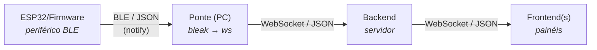

# Decisão de Arquitetura - Stack Tecnológica

- **Atividade:** 3.1 - Decidir e justificar a stack - [issue #251](https://github.com/fcte-pi1/2026.2_PI1_Grupo1_Diogo/issues/251)
- **Épico:** Arquitetura (4+1)
- **Responsáveis:** Gustavo Oki / Samuel
- **Entrega da etapa (AP5):** 28/09/2026
- **Projeto:** Rato Borrachudo
- **Grupo 1 - PI1 2026/2**

---

## 1. Objetivo e escopo

Este documento **decide e justifica** a stack tecnológica do software - padrão arquitetural, linguagens, frameworks/bibliotecas e banco de dados -, conforme exigido pelo `4.4 - Projeto conceitual de software.md`. As decisões aqui são a base das **visões 4+1** (atividades 3.2, 3.4, 3.5) e do **modelo de dados MER/DER** (atividade 3.3, que apenas detalha o banco escolhido aqui).

Cada decisão está fundamentada em requisitos de `2 - Requisitos.md`. As escolhas são **recomendações da Gerência a serem ratificadas** por cada subfrente antes da AP5; os pontos que ainda dependem de confirmação estão na seção 11.

## 2. Visão geral da arquitetura

O sistema é **cliente-servidor distribuído**, em **rede local isolada** (RNF-41), com três subsistemas de software e um protocolo de comunicação comum:

- **Firmware (ESP32):** navegação autônoma e emissão de telemetria. Opera como **periférico BLE (GATT server)** e emissor unidirecional (RF-51, RF-53); a telemetria sai por **BLE** (Nordic UART Service, _notify_).
- **Ponte (PC):** processo em Python que assina as notificações BLE do robô e **repassa o mesmo JSON ao backend por WebSocket**. Isola o transporte sem fio do robô (BLE) do protocolo de aplicação a jusante (WebSocket), que **não muda**.
- **Backend:** servidor que recebe, valida, persiste, deriva métricas e distribui a telemetria aos painéis.
- **Frontend:** painel web (_dashboard_) que exibe a tentativa em tempo real e o histórico.
- **Protocolo:** mensagens **JSON**, com esquema versionado; transportadas por **BLE** no primeiro salto (robô $\rightarrow$ ponte) e por **WebSocket** do PC em diante (ponte $\rightarrow$ backend $\rightarrow$ painéis).

## 3. Padrão arquitetural (por subfrente)

O padrão MVC/MVP se aplica a sistemas com interface e interação de usuário; por isso ele é adotado no frontend, mas **não** no firmware nem no backend, que têm naturezas diferentes. As escolhas por subfrente:

| Subfrente    | Padrão adotado                                                                                     | Justificativa                                                                                                                                                                                                                                                                                                                                                                                                                                                                                                                                                                                 |
| :----------- | :------------------------------------------------------------------------------------------------- | :-------------------------------------------------------------------------------------------------------------------------------------------------------------------------------------------------------------------------------------------------------------------------------------------------------------------------------------------------------------------------------------------------------------------------------------------------------------------------------------------------------------------------------------------------------------------------------------------- |
| **Firmware** | **Monólito modular em camadas** (FSM + tarefas FreeRTOS)                                           | O firmware é um binário embarcado único (monólito) organizado em módulos e camadas - HAL $\rightarrow$ _drivers_ de sensores/atuadores $\rightarrow$ domínio (sensoriamento, mapeamento, Flood Fill, controle de movimento, telemetria) $\rightarrow$ controle. Como o comportamento já é definido por seis estados de navegação (RF-54), a **máquina de estados (FSM)** é o núcleo de controle, e duas **tarefas FreeRTOS** separam **navegação** e **telemetria**, atendendo ao isolamento exigido pelo RNF-33 (falha de BLE/telemetria não pode afetar a navegação). MVC não se aplica: não há interface gráfica embarcada. |
| **Backend**  | **Monólito modular em camadas** (ingestão $\rightarrow$ validação $\rightarrow$ domínio $\rightarrow$ persistência $\rightarrow$ distribuição) | O escopo (1 robô, ~10 painéis, RNF-51) não justifica microsserviços, cujo overhead operacional contraria a implantação simples exigida (RNF-58: subir com um único comando em ≤ 2 min). Um monólito modular em camadas mantém baixo acoplamento entre ingestão WebSocket, validação de esquema/domínio (RF-75, RF-76), derivação de métricas (RF-82…85) e persistência (RF-79, RF-80), e é mais simples de testar (RNF-53).                                                                                                                                                                   |
| **Frontend** | **Componentizado (padrão MVVM/Flux)**                                                              | O React organiza a interface em componentes reutilizáveis, com um _view-model_ (hooks/store) que separa o tratamento do fluxo WebSocket da apresentação. Essa separação sustenta a atualização reativa em tempo real (RF-58) e o desempenho exigido (RNF-38: ≥ 30 fps a 10 msg/s).                                                                                                                                                                                                                                                                                                            |

## 4. Linguagens de programação

| Subfrente    | Linguagem                             | Justificativa                                                                                                                                                                                                                                                                                                                                                                                         |
| :----------- | :------------------------------------ | :---------------------------------------------------------------------------------------------------------------------------------------------------------------------------------------------------------------------------------------------------------------------------------------------------------------------------------------------------------------------------------------------------- |
| **Firmware** | **C++** (padrão do ecossistema ESP32) | Acesso de baixo nível a I²C, PWM/LEDC, interrupções de encoder (RF-42, RF-47) e controle determinístico de tempo real, com amplo suporte de bibliotecas para os sensores do projeto.                                                                                                                                                                                                                  |
| **Backend**  | **TypeScript** sobre **Node.js**      | Os requisitos já pressupõem Node: _event loop_ não bloqueante (RNF-49), simulador de robô **em Node** (RNF-53) e implantação com um comando (RNF-58). O modelo assíncrono orientado a eventos do Node é ideal para muitas conexões WebSocket simultâneas (RNF-51). O TypeScript adiciona tipagem estática, que reduz erros ao lidar com o esquema do protocolo e as regras de domínio (RF-75, RF-76). |
| **Frontend** | **TypeScript** (+ HTML/CSS)           | Mesma linguagem do backend reduz troca de contexto e permite compartilhar os tipos do protocolo. Tipagem estática ajuda na consistência dos dados de telemetria exibidos.                                                                                                                                                                                                                             |

> Observação: se a equipe julgar o prazo apertado para adotar TypeScript no front/back, JavaScript puro é aceitável; a recomendação é TypeScript pela segurança de tipos no protocolo.

## 5. Frameworks e bibliotecas

**Firmware (ESP32)**

- **ESP-IDF v5.x** (sobre FreeRTOS): framework oficial da Espressif, adotado pela placa ESP32-S3-N16R8. Dá controle direto dos periféricos (I²C, LEDC/PWM, PCNT) e da pilha **BLE NimBLE**, com build por CMake. (O framework Arduino-ESP32 foi descartado por não expor a pilha BLE e os periféricos no nível exigido.)
- **Bibliotecas/componentes**: drivers nativos do ESP-IDF para **I²C** (`i2c_master`), **LEDC** (PWM dos motores) e **PCNT** (contagem de encoders); **VL53L1X** (componente ESP-IDF) para os ToF; **MPU-6050** e **INA219** via I²C; **esp-nimble-cpp** (NimBLE) para a emissão de telemetria por **BLE** (Nordic UART Service); **PID próprio** para a malha de equalização (RF-43).
- **Testes**: **GoogleTest** em **build de host (CMake)** — o núcleo (domínio/casos de uso/portas) é C++17 puro e roda no PC sem o microcontrolador, para a lógica de Flood Fill, odometria, protocolo e demais derivações desacopladas do hardware.

**Backend (Node.js)**

- **`ws`**: servidor WebSocket leve, para ingestão do robô e distribuição aos painéis (RF-72, RF-88).
- **Fastify** (ou Express): API REST de consulta - histórico, filtros, paginação, _leaderboard_ (RF-93, RF-95).
- **Ajv** (JSON Schema): validação de cada mensagem contra o esquema da versão do protocolo (RF-75).
- **PostgreSQL**: acesso ao banco.
- **Testes**: **Vitest** (ou Jest) + o **simulador de robô em Node** (RNF-53), com cobertura ≥ 80% nos módulos de validação e derivação.

**Frontend (web)**

- **React + Vite**: o Vite empacota todos os assets localmente no _build_, o que atende ao requisito crítico de **operação offline sem CDNs/fontes/APIs externas** (RNF-41).
- **Canvas 2D**: renderização da malha do labirinto e do trajeto (RF-60, RF-61) - melhor desempenho que SVG para atualização contínua e retenção de 6.000 amostras (RNF-38, RNF-40).
- **uPlot**: gráficos de consumo (tensão/corrente/potência) leves e rápidos (RF-68); alternativa mais simples: Chart.js.
- **Zustand** (ou Context API): estado da aplicação e buffer da tentativa.

## 6. Protocolo de comunicação

- **Transporte:** do robô ao PC, **BLE** (_notify_ sobre o Nordic UART Service, RNF-6); do PC em diante, **WebSocket** sobre a rede local, provido pela **ponte** BLE $\rightarrow$ WebSocket. O protocolo de aplicação (JSON) é o mesmo nos dois saltos.
- **Formato:** mensagens **JSON**, cada uma carregando a **versão do protocolo** (RF-57); o backend aceita a versão atual e a anterior, com o **esquema publicado no repositório** (RNF-57).
- **Sentido:** o robô é **emissor unidirecional** (RF-53); os painéis são somente leitura (RNF-55).
- **Confiabilidade:** numeração de sequência, confirmação cumulativa (_ack_) e idempotência garantem 0 duplicatas e 0 lacunas após quedas (RF-74, RF-77, RNF-50).

## 7. Resumo da stack

| Camada           | Padrão                                                          | Linguagem          | Principais frameworks/bibliotecas                                                                        | Persistência                |
| :--------------- | :-------------------------------------------------------------- | :----------------- | :------------------------------------------------------------------------------------------------------- | :-------------------------- |
| Firmware (ESP32) | Monólito modular em camadas, arquitetura limpa (FSM + FreeRTOS) | C++17              | ESP-IDF v5.x, drivers I²C/LEDC/PCNT, VL53L1X, MPU-6050, INA219, esp-nimble-cpp (NimBLE/BLE), PID próprio | - (estado em memória)       |
| Backend          | Monólito modular em camadas                                     | TypeScript/Node.js | ws, Fastify, Ajv, PostgreSQL, Vitest                                                                     | **PostgreSQL (relacional)** |
| Frontend         | Componentizado (MVVM/Flux)                                      | TypeScript         | React, Vite, Canvas 2D, uPlot, Zustand                                                                   | Buffer em memória           |
| Comunicação      | Cliente-servidor (com ponte BLE $\rightarrow$ WS)                            | JSON               | BLE/NUS (robô $\rightarrow$ ponte) + WebSocket (ponte $\rightarrow$ backend/painéis), JSON Schema (Ajv)                            | -                           |

## 8. Rastreabilidade das decisões (decisão $\rightarrow$ requisitos)

| Decisão                               | Requisitos que a fundamentam                      |
| :------------------------------------ | :------------------------------------------------ |
| FSM + tarefas FreeRTOS no firmware    | RF-54, RNF-33                                     |
| Node.js no backend                    | RNF-49, RNF-51, RNF-53, RNF-58                    |
| Monólito modular (não microsserviços) | RNF-58, RNF-51                                    |
| React + Vite, empacotamento local     | RNF-41, RNF-44, RNF-45                            |
| Canvas + uPlot (desempenho)           | RNF-38, RNF-40, RF-60, RF-61, RF-68               |
| Banco relacional / SQLite             | RF-77, RF-79, RF-80, RF-93, RF-95, RNF-54, RNF-58 |
| WebSocket + JSON versionado           | RNF-6, RF-57, RF-75, RNF-57                       |

## 9. Riscos e mitigações

- **Desempenho de renderização** com 6.000 amostras (RNF-40). Mitigação: Canvas + _downsampling_ nos gráficos (uPlot) e limite de 10 atualizações contínuas/s já imposto pelo backend (RF-90).
- **Curva de TypeScript/ESP-IDF** para parte da equipe. Mitigação: começar pelos módulos desacoplados de hardware (Flood Fill, derivações) testados no PC com GoogleTest, e usar o simulador em Node.
