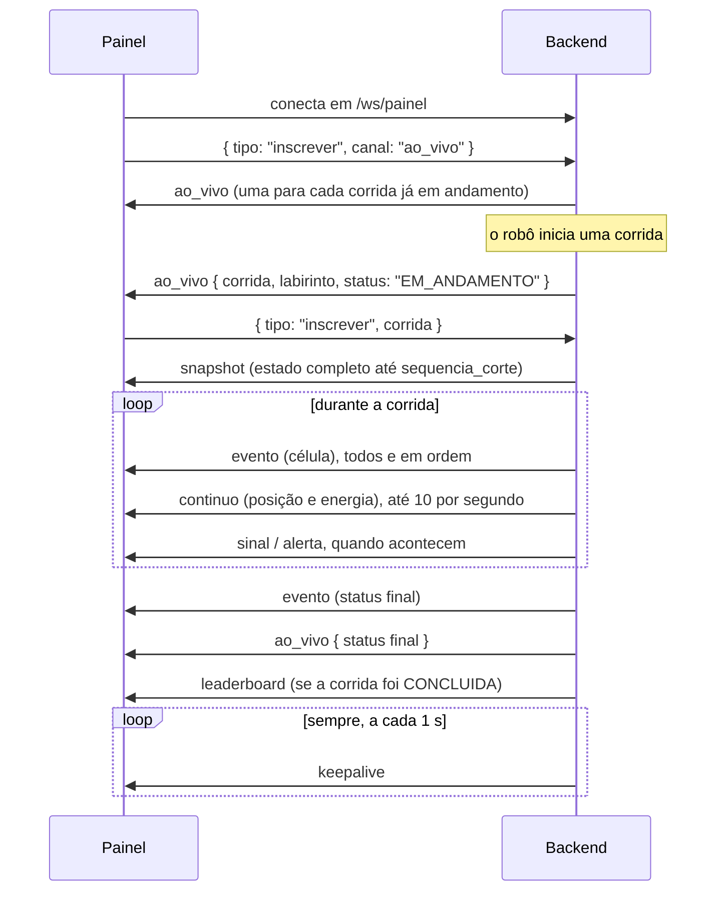

# Protocolo do painel — `/ws/painel`

Como o backend entrega as corridas aos painéis em tempo real (RF-88 a RF-92). Os tipos TypeScript de todas as mensagens estão em [`../tipos.ts`](../tipos.ts), na seção "Backend → Painel", e chegam ao frontend pelo alias `@protocolo`.

O painel é **somente leitura** (RNF-55): ele só se inscreve e cancela inscrições. Uma mensagem inválida do painel é ignorada e registrada no log do backend, sem derrubar a conexão.

## Fluxo típico

## Painel → backend

| Mensagem | Efeito |
|:--|:--|
| `{ "tipo": "inscrever", "canal": "ao_vivo" }` | Passa a receber os anúncios de todas as corridas. Recebe na hora um `ao_vivo` para cada corrida já em andamento |
| `{ "tipo": "cancelar", "canal": "ao_vivo" }` | Deixa de receber os anúncios |
| `{ "tipo": "inscrever", "corrida": "<uuid>" }` | Recebe um `snapshot` na hora e, depois, os eventos e contínuos dessa corrida |
| `{ "tipo": "cancelar", "corrida": "<uuid>" }` | Deixa de receber os dados da corrida |

`corrida` é sempre o id (UUID) da corrida no backend, o que vem nos `ao_vivo`, e não o id gerado pelo robô.

A inscrição só vale para corridas que o backend tem em memória: as em andamento e as que terminaram depois do último reinício do backend. Para uma corrida antiga, nada é enviado; use `GET /api/corridas/{id}` (ver [`API.md`](API.md)).

## Backend → painel

| `tipo` | Quem recebe | Quando |
|:--|:--|:--|
| `ao_vivo` | Inscritos no canal | Início da corrida (`EM_ANDAMENTO`) e cada mudança de status |
| `snapshot` | Quem acabou de se inscrever na corrida | Logo depois do `inscrever` |
| `evento` (`celula`) | Inscritos na corrida | A cada célula visitada, **todas e em ordem de sequência** |
| `evento` (`status`) | Inscritos na corrida | Fim (`CONCLUIDA`, `FALHOU`) ou interrupção (`INTERROMPIDA`) |
| `continuo` | Inscritos na corrida | Posição e energia, **no máximo 10 por segundo** por corrida |
| `sinal` | Inscritos na corrida | `PERDIDO` após 3 s sem mensagens do robô; `RETOMADO` quando ele volta |
| `alerta` | Inscritos na corrida | Tensão abaixo de 7,0 V (`TENSAO_BAIXA`), sem repetir a cada leitura |
| `leaderboard` | Inscritos no canal | Uma corrida terminou `CONCLUIDA`: o ranking daquele labirinto pode ter mudado. Sai depois de a corrida estar gravada, então o `GET /api/leaderboard` feito ao recebê-lo já a inclui |
| `keepalive` | Todos os painéis | A cada 1 s, também fora das corridas |

### Regras para o painel

- **O `snapshot` substitui, não mescla.** Ele traz o estado até `sequencia_corte`. Os eventos que chegam depois têm sequência maior; um evento com sequência ≤ `sequencia_corte` já está no snapshot.
- **O `snapshot` não traz o trajeto nem a série de energia,** só o mapa (as células conhecidas, com as paredes) e a posição. Para o trajeto e o gráfico de quem entra no meio da corrida, use `GET /api/corridas/{id}`.
- **`labirinto` pode vir `null`** no `snapshot` e no `ao_vivo`. Acontece quando a corrida foi criada antes de o `inicio_corrida` chegar.
- **Um `evento` de status com `sequencia: null`** é uma interrupção: 120 s sem sinal (`SEM_SINAL`) ou reinício do robô (`REINICIO_ROBO`). Ela não vem de uma mensagem do robô e **não deve ser descartada** por sequência.
- **O `continuo` sempre traz a última posição e a última energia conhecidas.** Um dos dois pode ser `null` se ainda não houve leitura. O campo `metricas` traz as métricas atuais.
- **`metricas`** está em todo `evento` e `continuo`, com valores atuais: tempo decorrido, células percorridas, distância, velocidade média, tensão, corrente, potência, carga estimada e ΔV. `tempo_conclusao_ms` só aparece quando a corrida termina com sucesso.
- **O `keepalive` não é telemetria.** Ele existe para o *watchdog* de conexão do painel: sem nenhuma mensagem por 3 s, a conexão caiu.

## Painel lento (RF-91)

Se o buffer de envio de um painel passar de 1 MB, ele deixa de receber os `continuo`, mas continua recebendo os eventos. Se isso durar 10 s, o backend fecha a conexão com o código **`1013`** ("tente de novo mais tarde"). O painel deve reconectar e se inscrever de novo; o `snapshot` traz o estado atualizado.
