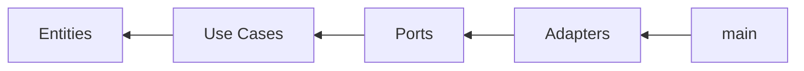

# Guia de desenvolvimento do firmware

Como o firmware do micromouse está organizado e como **compilar, testar, medir cobertura (no PC)** e **gravar na placa** (ESP32-S3).

> **Público:** quem mexe no código do firmware. Se você é de **outra equipe** (Eletrônica, Energia, Backend) e só precisa *usar* o firmware, comece pelo [`INTEGRACAO_FIRMWARE.md`](INTEGRACAO_FIRMWARE.md) - ele descreve as fronteiras, os contratos e **todas as ferramentas a instalar por equipe**.

## Arquitetura

O projeto segue **arquitetura limpa**: as dependências apontam sempre para dentro. O núcleo (domínio, casos de uso, portas) é C++17 puro e **não conhece hardware**; os *adapters* ficam na borda e **implementam as portas**.



Por isso existem **dois alvos de build** sobre o mesmo código-fonte:

| Alvo      | Onde                              | Compila                          | Precisa de placa? |
| :-------- | :-------------------------------- | :------------------------------- | :---------------: |
| **Host**  | raiz (`CMakeLists.txt` + presets) | núcleo (A–K) + testes            |        não        |
| **Placa** | `esp32/` (ESP-IDF)                | núcleo + adapters (L–P) + `main` |        sim        |

O build de host compila **apenas o núcleo** - os adapters (`src/adapters/`) incluem `driver/*.h`, que só existe no ESP-IDF, então ficam de fora dos testes. O build da placa compila tudo.

## Estrutura do projeto

```text
firmware/
├── CMakeLists.txt          # build de HOST (núcleo + testes) + opções
├── CMakePresets.json       # presets: debug / release / coverage
├── .clang-format           # estilo (base Google, indent 4, 100 colunas)
├── GUIA_DESENVOLVIMENTO.md  # este guia (firmware)
├── INTEGRACAO_FIRMWARE.md   # guia para as outras equipes (contratos + ferramentas)
├── include/                # headers (.hpp), por camada
│   ├── domain/             # Maze, FloodFill, Odometry, DipDecoder, Pid, Maneuver
│   ├── controller/         # MotionController
│   ├── use_cases/          # Navigator, SessionManager
│   ├── ports/              # Sensor/Motion/Signal/Telemetry (interfaces)
│   ├── protocol/           # ProtocolV1
│   ├── telemetry/          # TelemetryEmitter, TelemetryBuffer
│   └── adapters/           # hardware (só compila no alvo ESP-IDF); BoardPins.hpp aqui
├── src/                    # implementação (.cpp), espelha include/
│   ├── main.cpp        # composition root (ESP-IDF) - parâmetros físicos
│   └── main.cpp            # stub do host (o executável "firmware")
├── test/                   # testes nativos (GoogleTest)
│   ├── <camada>/*Test.cpp
│   ├── simulation/         # SimulatedRobot (duplo que implementa as portas)
│   └── spy/                # SpySignalPort, SpyTelemetryPort
├── esp32/                  # subprojeto ESP-IDF (alvo placa)
│   ├── sdkconfig.defaults  # config da N16R8 (16 MB, PSRAM, BLE/NimBLE)
│   ├── partitions.csv
│   └── main/CMakeLists.txt # registra núcleo + adapters + main
│       main/idf_component.yml   # dependências da placa (esp-nimble-cpp)
└── bridge/                 # ponte BLE -> WebSocket (Python, roda no PC)
```

## Pré-requisitos

A lista completa de instalação, por equipe e por sistema operacional, está no [`INTEGRACAO_FIRMWARE.md` §0](INTEGRACAO_FIRMWARE.md). Resumo para o firmware:

| Ferramenta       | Versão             | Uso                                                |
| :--------------- | :----------------- | :------------------------------------------------- |
| CMake            | ≥ 3.21             | Build de host (os presets exigem 3.21)             |
| GCC/G++ ou Clang | C++17              | Compilador do host                                 |
| gcovr            | -                  | Relatório de cobertura (opcional)                  |
| ESP-IDF          | v5.x (testado 5.3) | Build/gravação na placa (traz toolchain + esptool) |
| Python           | ≥ 3.10             | Ponte BLE -> WebSocket                             |

O **GoogleTest não precisa ser instalado**: o CMake baixa a versão 1.17.0 via `FetchContent` na 1ª configuração (precisa de internet nesse momento). O **esp-nimble-cpp** é resolvido pelo *component manager* do ESP-IDF.

## Build de host (núcleo + testes) - sem placa

### Presets

| Preset     | Build   | Testes | Cobertura | Saída             |
| :--------- | :------ | :----- | :-------- | :---------------- |
| `debug`    | Debug   | sim    | não       | `build/debug/`    |
| `release`  | Release | não    | não       | `build/release/`  |
| `coverage` | Debug   | sim    | sim       | `build/coverage/` |

### Compilar e testar

```bash
cmake --preset debug             # configura (1ª vez)
cmake --build --preset debug     # compila núcleo + testes
ctest --preset debug             # roda os testes (81)
```

Formas úteis:

```bash
ctest --preset debug -R Maze                              # filtra por nome
./build/debug/test/firmware_tests                         # binário direto (saída GoogleTest)
./build/debug/test/firmware_tests --gtest_filter='Maze.*' # filtra pela suíte
```

### Cobertura

```bash
cmake --preset coverage
cmake --build --preset coverage --target coverage
```

Gera resumo no terminal e HTML em `build/coverage/coverage/index.html`. O build **falha se a cobertura de linhas ficar abaixo de 80%**. Sem o gcovr, o alvo `coverage` apenas não é criado (aviso).

## Build da placa (firmware completo) - ESP-IDF

Compila o projeto **por inteiro** (núcleo + adapters + `main`).

```bash
. ~/esp/esp-idf/export.sh            # ativa o ESP-IDF no terminal
idf.py -C esp32 reconfigure          # baixa deps do idf_component.yml (esp-nimble-cpp 2.x)
idf.py -C esp32 set-target esp32s3   # 1ª vez
idf.py -C esp32 build                # compila tudo
idf.py -C esp32 -p /dev/ttyACM0 flash monitor   # grava e monitora (ajuste a porta)
```

O `-C esp32` aponta para o subprojeto `esp32/`, que reutiliza `../include` e `../src` (inclusive `src/adapters/` e `src/main.cpp`).

> **Sensores ToF (VL53L1X):** as leituras de distância estão como *stub* (retornam 9999) e a dependência do componente está comentada em `esp32/main/idf_component.yml`, então o firmware **compila e grava** mesmo assim (o sensoriamento de parede fica inativo). Para ler os ToF de verdade: escolha o componente VL53L1X, descomente/ajuste a dependência, rode `idf.py -C esp32 reconfigure` e implemente as leituras reais em `src/adapters/Vl53l1xSensorAdapter.cpp`.

### Onde mexer quando o hardware muda

- **Pinos:** `include/adapters/BoardPins.hpp` (ponto único de verdade; segue o `4.3 §9`). Trocou um pino na placa? Altere só aqui.
- **Parâmetros físicos** (roda, pulsos/volta, bitola): `src/main.cpp` (`WheelConfig`, `TurnConfig`). **Aferir em bancada** antes da corrida.
- **Calibração de energia** (resistor de *shunt*): adapter `Ina219`.

## Ponte BLE -> WebSocket - no PC

```bash
cd bridge
python3 -m venv .venv && source .venv/bin/activate   # no fish: source .venv/bin/activate.fish
pip install -r requirements.txt
```

Operação e testes sem placa / sem Bluetooth (detalhes em `bridge/README.md`):

```bash
# BLE real  ->  só imprime o que o robô envia
python ble_ws_bridge.py --print-only

# BLE real  ->  WebSocket do backend
python ble_ws_bridge.py --ws ws://localhost:8080/ws/telemetria

# SEM placa/BLE: telemetria de exemplo (protocolo v1)
python ble_ws_bridge.py --simulate --print-only
python ble_ws_bridge.py --simulate --ws ws://localhost:8080/ws/telemetria

# SEM placa/BLE: reenvia linhas JSON exatas de um arquivo
python ble_ws_bridge.py --replay amostra.jsonl --ws ws://localhost:8080/ws/telemetria

# Alvo de teste no lugar do backend (imprime o que recebe)
python test_ws_server.py [--ack]
```

## Fluxo TDD (código novo do núcleo)

1. **Escreva o teste primeiro** em `test/<camada>/<Modulo>Test.cpp` e registre-o em `test/CMakeLists.txt` (dentro do `add_executable(firmware_tests ...)`).
2. **Declare a interface** em `include/<camada>/<Modulo>.hpp`.
3. **Implemente** em `src/<camada>/<Modulo>.cpp` e adicione o arquivo à `firmware_logic` no `CMakeLists.txt` da raiz.
4. **Rode os testes** (`ctest --preset debug`) até passarem.
5. **Confira a cobertura** (`cmake --build --preset coverage --target coverage`) antes do merge request.

Os nomes de testes e variáveis no código são em inglês; os testes são descobertos por `gtest_discover_tests` (não é preciso registrar cada `TEST`).

### Adapters (hardware)

Adapters **não** têm teste de unidade (dependem de hardware). Para adicionar um: declare em `include/adapters/`, implemente em `src/adapters/` e registre o `.cpp` em `esp32/main/CMakeLists.txt`. Valide em bancada. Mantenha a regra: o adapter **implementa uma porta** de `ports/` - o núcleo nunca inclui `driver/*.h`.

## Solução de problemas

| Problema                                                           | Causa / Solução                                                                                                                      |
| :----------------------------------------------------------------- | :----------------------------------------------------------------------------------------------------------------------------------- |
| Erro ao baixar o GoogleTest                                        | Verifique a internet; o download ocorre só na 1ª configuração                                                                        |
| `gcovr not found`                                                  | Instale o gcovr e rode `cmake --preset coverage` de novo                                                                             |
| IntelliSense não acha os headers                                   | Rode `cmake --preset debug` (gera `compile_commands.json`)                                                                           |
| `driver/gpio.h: No such file`                                      | Você tentou compilar adapter no build de host; adapters só compilam via `idf.py -C esp32`                                            |
| `idf.py: command not found`                                        | Rode `. ~/esp/esp-idf/export.sh` naquele terminal                                                                                    |
| `no versions of h2zero/esp-nimble-cpp match ^1.5`                  | Versão inexistente; o manifesto usa `^2.0.0` (API 2.x). Rode `idf.py -C esp32 reconfigure`                                           |
| `conflicting declaration 'pcnt_unit_t'`                            | Conflito de drivers PCNT: use o **novo** `driver/pulse_cnt.h` (não o legado `driver/pcnt.h`) nos adapters de encoder                 |
| `Could not open /dev/ttyACM0 ... No such file`                     | A placa não está conectada/visível. Veja a porta real: `ls /dev/ttyACM* /dev/ttyUSB*`; ajuste o `-p`. Sem placa, não há o que gravar |
| `flash`: *Permission denied* na porta                              | Entre no grupo `dialout`: `sudo usermod -aG dialout $USER` (logout/login)                                                            |
| Ponte: `org.bluez was not provided`                                | BlueZ inativo/ausente (ou WSL sem Bluetooth). `sudo systemctl enable --now bluetooth`; ou use `--simulate`/`--replay`                |
| `apt install` com `404 Not Found`                                  | Índice do apt desatualizado: `sudo apt update` e reinstale                                                                           |
| fish: `'case' builtin not inside of switch block` ao ativar o venv | Script errado para o shell: `source .venv/bin/activate.fish` (ou rode `.venv/bin/python` direto)                                     |
| Falha ao baixar componente no `reconfigure`                        | Confirme o nome/versão no `esp32/main/idf_component.yml` e a internet                                                                |
