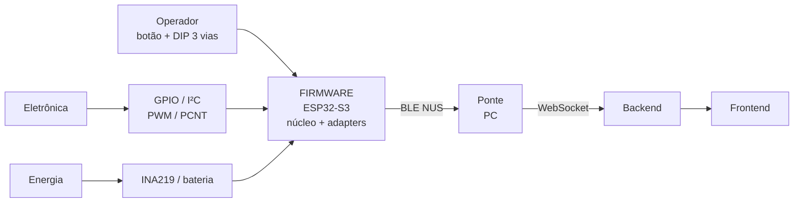

# Guia de Integração do Firmware — "Rato Borrachudo"

> **Para quem é este documento.** Para as **outras equipes** que precisam usar o
> firmware sem conhecer o C++ por dentro: **Eletrônica/Hardware**, **Energia**,
> **Backend/Ponte** e o **Operador**. Ele descreve os *contratos* (as fronteiras)
> do firmware — o que cada equipe precisa entregar a ele e o que recebe de volta.
> Para compilar, testar e gravar, veja o [`GUIA_DESENVOLVIMENTO.md`](GUIA_DESENVOLVIMENTO.md).

O firmware segue **arquitetura limpa**: o núcleo (mapa, Flood Fill, navegação,
odometria, protocolo) é agnóstico de hardware e os *adapters* ficam na borda.
Para quem integra, isso tem um efeito prático importante: **quase toda mudança de
hardware se resolve num único arquivo** (`include/adapters/BoardPins.hpp`), sem
tocar na lógica testada.



As quatro fronteiras do firmware:

| Fronteira | Equipe | Documento de referência |
| :--- | :--- | :--- |
| Pinos, periféricos I²C, motores, encoders | Eletrônica/Hardware | §1 abaixo + `4.3 - Projeto conceitual de hardware` |
| Medição de consumo, parâmetros físicos | Energia / Mecânica | §2 abaixo + `4.2` / `4.1` |
| Telemetria (BLE → ponte → WebSocket) | Backend | §3 e §4 abaixo |
| Botão de início e DIP switch | Operador | §5 abaixo |

---

## 0. Ferramentas a instalar (por equipe)

Nem toda equipe precisa de tudo. A tabela resume o que cada uma instala; os
comandos vêm logo abaixo. Comandos de pacote usam **Ubuntu/Debian** (`apt`);
em outra distro troque o gerenciador; em Windows/macOS, veja as notas.

| Ferramenta | Para quê | Quem precisa |
| :--- | :--- | :--- |
| **git** | Clonar o repositório | Todos |
| **ESP-IDF v5.x** (traz toolchain, CMake, Ninja, Python, **esptool**) | Compilar e **gravar na placa** | Firmware |
| **CMake ≥ 3.21 + GCC/G++ (ou Clang)** | **Testes no PC** (host), sem placa | Firmware, QA |
| **gcovr** | Relatório de **cobertura** (opcional) | Firmware, QA |
| **Python ≥ 3.10 + venv** | Rodar a **ponte** e os modos de teste | Backend, Integração |
| **bleak, websockets** (via `requirements.txt`) | Dependências da ponte | Backend, Integração |
| **BlueZ + adaptador Bluetooth** | **BLE real** (só com o robô) | Integração |

> O **GoogleTest NÃO precisa ser instalado**: o CMake o baixa (versão 1.17.0)
> via `FetchContent` na 1ª configuração. O **esp-nimble-cpp** (NimBLE) e o
> componente **VL53L1X** também não se instalam à mão: o *component manager* do
> ESP-IDF os resolve a partir de `esp32/main/idf_component.yml` no `reconfigure`.

### 0.1 Comum a todos
```bash
sudo apt update && sudo apt install -y git
git clone <url-do-repositorio> && cd 2026.2_PI1_Grupo1_Diogo/src/firmware
```

### 0.2 Firmware — testes no PC (sem placa)
```bash
sudo apt install -y build-essential cmake gcovr
# build-essential = gcc/g++/make; cmake deve ser ≥ 3.21 (confira: cmake --version)
```
Depois: `cmake --preset debug && ctest --preset debug` (ver `GUIA_DESENVOLVIMENTO.md`).

### 0.3 Firmware — compilar e gravar na placa (ESP-IDF)
O ESP-IDF traz **tudo** para a placa (compilador xtensa, CMake, Ninja, ambiente
Python e o **esptool** de gravação). Instale uma vez:
```bash
sudo apt install -y git wget flex bison gperf python3 python3-venv python3-pip \
     cmake ninja-build ccache libffi-dev libssl-dev dfu-util libusb-1.0-0
mkdir -p ~/esp && cd ~/esp
git clone -b v5.3 --recursive https://github.com/espressif/esp-idf.git
cd esp-idf && ./install.sh esp32s3
```
Em **cada terminal** onde for usar o ESP-IDF, ative o ambiente:
```bash
. ~/esp/esp-idf/export.sh        # no fish: use o export.fish, se disponível
```
Gravar na placa precisa de acesso à **porta serial** — entre no grupo `dialout`
uma vez e refaça login:
```bash
sudo usermod -aG dialout $USER
```
> **Windows:** use o *ESP-IDF Tools Installer* (instala toolchain + esptool) ou o
> *ESP-IDF VS Code Extension*. **macOS:** `./install.sh` após instalar `cmake`,
> `ninja` e `python` (Homebrew).

### 0.4 Ponte BLE→WebSocket (Backend / Integração)
```bash
cd bridge
python3 -m venv .venv
source .venv/bin/activate          # no fish: source .venv/bin/activate.fish
pip install -r requirements.txt    # instala bleak e websockets
```
Para o **servidor WebSocket de teste** basta o `websockets` (já vem no
`requirements.txt`). Os modos `--simulate`/`--replay` **não exigem Bluetooth**.

### 0.5 BLE real (só quando houver robô)
No Linux, o `bleak` fala com o **BlueZ** via D-Bus e precisa de um adaptador BT:
```bash
sudo apt update          # evita 404 por índice desatualizado
sudo apt install -y bluetooth bluez
sudo systemctl enable --now bluetooth
systemctl status bluetooth     # deve estar "active (running)"
bluetoothctl list              # deve listar um controlador
```
> ⚠️ **WSL não tem Bluetooth** por padrão (sem BlueZ funcional e sem rádio): rode
> a ponte em **BLE real** no SO nativo, ou use `--simulate`/`--replay` no WSL.

### 0.6 Versões de referência (testadas)

| Ferramenta | Versão |
| :--- | :--- |
| ESP-IDF | v5.3 (alvo `esp32s3`) |
| CMake | ≥ 3.21 |
| Python | ≥ 3.10 (a ponte roda em 3.14) |
| esp-nimble-cpp | `^2.0.0` (resolvido pelo component manager) |
| GoogleTest | 1.17.0 (baixado por FetchContent) |

---

## 1. Contrato com a Eletrônica / Hardware

### 1.1 Mapa de pinos (fonte da verdade: `4.3 §9`)

O firmware já está configurado com o **pinout da placa fabricada** (MM-ESP32-V1).
Se a eletrônica mudar qualquer pino, **basta avisar**: altera-se **uma única
constante** em `include/adapters/BoardPins.hpp` e nada mais muda.

| Função | GPIO | Net (esquemático) |
| :--- | :--: | :--- |
| I²C SDA | 2 | `SDA` |
| I²C SCL | 1 | `SCL` |
| XSHUT ToF frontal | 18 | `X_FRENTE` |
| XSHUT ToF esquerdo | 17 | `X_ESQ` |
| XSHUT ToF direito | 3 | `X_DIR` |
| Motor esquerdo (M2) IN1 / IN2 | 6 / 5 | `M2_IN1` / `M2_IN2` |
| Motor direito (M1) IN1 / IN2 | 16 / 15 | `M1_IN1` / `M1_IN2` |
| Encoder esquerdo A / B | 41 / 40 | `ENC2_A` / `ENC2_B` |
| Encoder direito A / B | 38 / 39 | `ENC1_A` / `ENC1_B` |
| LED "pronto" (status) | 9 | `LED_STATUS` |
| LED "erro" (debug) | 10 | `LED_DEBUG` |
| Buzzer | 11 | `BUZZER` |
| Botão de início | 4 | `START_BUTTON` |
| DIP via 1 / via 2 / via 3 | 7 / 8 / 46 | `DIP_SW1/2/3` |
| Interrupção da MPU-6050 | 42 | `INT_MPU` (hoje não usada — polling) |

### 1.2 Barramento I²C (crítico)

- Um único barramento compartilhado por **3× VL53L1X + MPU-6050 + INA219**.
- **Resistores de pull-up externos** em SDA e SCL (ex.: 4,7 kΩ a 3,3 V) são
  **obrigatórios** — o pull-up interno do ESP32 não basta para vários dispositivos.
- Endereços esperados pelo firmware:

  | Dispositivo | Endereço | Observação |
  | :--- | :--: | :--- |
  | INA219 | `0x40` | fixo (A0/A1 ao GND) |
  | MPU-6050 | `0x68` | fixo (AD0 ao GND) |
  | VL53L1X esquerdo | `0x30` | reendereçado no boot via `X_ESQ` |
  | VL53L1X frontal | `0x31` | reendereçado no boot via `X_FRENTE` |
  | VL53L1X direito | `0x32` | reendereçado no boot via `X_DIR` |

- ⚠️ **São 3 ToF** (frontal + 2 laterais), conforme `4.3 §5.2`. Cada um precisa do
  seu **XSHUT** num GPIO próprio: todos nascem em `0x29` e o firmware os separa
  ligando um por vez e atribuindo o endereço único. **Sem XSHUT individual, só um
  ToF funciona.**

### 1.3 Tração e encoders

- **DRV8833** por **PWM** (IN1/IN2 por motor, sem pino de *enable* fixo). Respeitar
  1,2 A contínuos / 2 A de pico por canal.
- **Encoders em quadratura** (canais A e B). O firmware conta por hardware (PCNT),
  decodificando as bordas do canal A (2×). Se A/B vierem trocados, o sentido
  inverte — **corrige-se no código**, basta avisar.

### 1.4 Interface local

- **2 LEDs** (pronto/erro), **buzzer** e **botão** de início (ativo em nível baixo,
  pull-up). O firmware aciona o buzzer por **nível (liga/desliga)** — assume
  **buzzer ativo**. Se for **passivo** (precisa de tom/PWM), avisar que trocamos o
  acionamento.

### 1.5 ✅ Checklist de entrega (Eletrônica → Firmware)

- [ ] ESP32-S3-N16R8 gravável por USB.
- [ ] I²C com pull-ups; 3× VL53L1X **com XSHUT individual**, MPU-6050 e INA219 respondendo.
- [ ] DRV8833 + 2 motores N20 + encoders A/B ligados.
- [ ] 2 LEDs, buzzer e botão; DIP de 3 vias.
- [ ] **Pinout final confirmado** (igual à §1.1 ou lista das diferenças).
- [ ] **Parâmetros da §2.2 entregues ao firmware.**

---

## 2. Contrato com a Energia / Mecânica

### 2.1 Medição de consumo

O **INA219** mede tensão/corrente/potência do barramento principal e alimenta a
telemetria de energia (RF-010). Os três valores (V, A, W) vão em cada mensagem
`energia`.

### 2.2 Parâmetros que viram constantes no firmware

Estes valores são **aferidos pela eletrônica/mecânica** e entram em
`src/app_main.cpp` (`WheelConfig`, `TurnConfig`) e na calibração do INA219.
**Sem eles corretos, odometria, giros e energia saem errados** — por isso hoje
estão como *placeholders* marcados no código:

| Parâmetro | Onde entra | Valor atual (placeholder) |
| :--- | :--- | :--- |
| Diâmetro da roda (mm) | `WheelConfig`/`TurnConfig` | 32 mm (conforme `4.3 §6.2`) |
| Pulsos por volta (eixo × decodificação) | `WheelConfig`/`TurnConfig` | 280 (≈140 PPR × 2 do PCNT) — **aferir** |
| Tamanho da célula (mm) | `WheelConfig` | 180 mm (conforme `4.3`) |
| Bitola — distância entre rodas (mm) | `TurnConfig` | 90 mm — **confirmar com a mecânica** |
| Resistor de *shunt* do INA219 (Ω) | calibração do adapter `Ina219` | **a informar** (ex.: 0,1 Ω) |
| Tipo de buzzer (ativo/passivo) | adapter `LocalInterface` | assume **ativo** |

> **Importante:** roda e célula já conferem com os documentos; **pulsos-por-volta
> e bitola devem ser medidos em bancada** antes da corrida final.

---

## 3. Contrato com o Backend — Telemetria (Opção A: BLE + ponte)

O robô **não fala WebSocket**. Ele **notifica BLE** (Nordic UART Service); uma
**ponte em Python** (pasta `bridge/`) roda no PC, assina as notificações e
**repassa o mesmo JSON ao backend por WebSocket**. Para o backend, **a ponte é só
mais um cliente WebSocket** em `/ws/telemetria` — o protocolo a jusante **não muda**.

```
[ESP32] --BLE/NUS notify (JSON + '\n')--> [ponte Python] --WebSocket/JSON--> [backend] --> [frontend]
```

- A ponte é o **cliente** WebSocket (o robô é emissor unidirecional; não processa
  mensagens de aplicação).
- Fragmentação: o firmware quebra mensagens grandes pelo MTU BLE; a ponte
  **remonta** por delimitador `'\n'` e envia **uma linha JSON por frame**.
- Fecho `4001` (token inválido) / `4002` (versão não suportada) é **fatal** (a
  ponte não reconecta). Qualquer outra queda → **reconexão automática** a cada 2 s.

### 3.1 Protocolo v1 — mensagens

Todas as mensagens são **JSON** com o envelope comum:

```json
{ "v": 1, "tipo": "<tipo>", "corrida": "<id>", "seq": <n>, "t": <ms>, ... }
```

| `tipo` | Quando | Campos próprios |
| :--- | :--- | :--- |
| `hello` | ao conectar | `dispositivo`, `versao` (autenticação pelo token no backend) |
| `inicio_corrida` | início de uma tentativa | `indice`, `labirinto` (ex.: `"8x4"`) |
| `estado` | a cada transição de fase | `estado` (ver §3.2) |
| `celula` | ao mapear uma célula | `x`, `y`, `n`, `l`, `s`, `o` (paredes: bool) |
| `posicao` | durante o percurso | `x`, `y`, `orientacao`, `celulas`, `velocidade?` |
| `energia` | periódico | `tensao`, `corrente`, `potencia` |
| `fim_corrida` | fim da tentativa | `resultado` (`"sucesso"`/`"falha"`), `detalhe?` |

### 3.2 Convenções (alinhar com o Frontend para não desenhar espelhado)

- **Coordenadas:** `x` = **coluna** (Leste positivo), `y` = **linha** (Sul positivo).
  Origem no **canto de partida**. `"8x4"` = **8 colunas × 4 linhas**.
- **Paredes** (`celula`): `n`/`l`/`s`/`o` = Norte/Leste/Sul/Oeste (`true` = parede).
- **Orientação** (`posicao`): `N`/`L`/`S`/`O`.
- **Estados** (`estado`), em maiúsculas: `INICIALIZANDO`, `AGUARDANDO`,
  `MAPEANDO`, `RESOLVENDO`, `CONCLUIDO`, `ERRO`.
- **`seq`** é monotônica por sessão; **`t`** é o tempo do robô em milissegundos.
- Após reconexão, o firmware **reenvia** o buffer retido (~60 s); o backend
  **deduplica por `seq`** (RF-74/RF-77). A ponte não inventa nem reordena.

---

## 4. Como testar a integração **sem o robô** (nem Bluetooth)

Isto permite ao Backend validar a ingestão e ao time todo exercitar a ponte antes
de a placa existir. Veja detalhes em [`bridge/README.md`](bridge/README.md).

```bash
cd bridge
python -m venv .venv && source .venv/bin/activate   # no fish: source .venv/bin/activate.fish
pip install -r requirements.txt
```

**a) Servidor WebSocket mínimo de teste** (substitui o backend; só imprime o que chega):
```bash
python test_ws_server.py            # escuta ws://localhost:8080/ws/telemetria
python test_ws_server.py --ack      # ainda responde um 'ack' informativo
```

**b) Ponte em modo simulação** (gera telemetria de exemplo, sem BLE):
```bash
python ble_ws_bridge.py --simulate --print-only                       # só imprime
python ble_ws_bridge.py --simulate --ws ws://localhost:8080/ws/telemetria
```

**c) Replay de linhas JSON exatas** (para schema estrito do backend):
```bash
python ble_ws_bridge.py --replay amostra.jsonl --ws ws://localhost:8080/ws/telemetria
```

Fluxo de validação ponta a ponta sugerido: suba o `test_ws_server.py` num
terminal e, noutro, rode `ble_ws_bridge.py --simulate --ws ...`; as mensagens
devem aparecer no servidor. Depois troque o servidor de teste pelo **backend
real** e repita. Quando o robô existir, troque `--simulate` pelo BLE real.

---

## 5. Contrato com o Operador

- **Antes de ligar:** posicionar o robô e configurar o **DIP de 3 vias** — vias 1
  e 2 escolhem o **tipo de labirinto** (4×4 / 8×4 / 12×4) e a via 3 o **canto de
  partida**. O DIP é lido **uma única vez, no boot** (RNF-35); mudar depois é
  ignorado.
- **Iniciar:** pressionar o **botão**. O firmware faz o auto-teste (LED/buzzer),
  inicia o anúncio BLE e começa a navegação. Em falha, vai direto a **Erro** e
  sinaliza pelo LED de erro/buzzer.
- A interface local permite operar **sem cabo e sem o PC** — relevante porque o
  enunciado proíbe alterar o código durante a resolução.

---

## 6. FAQ de integração

- **"Mudamos um pino na placa."** → Avisem o software; muda só `BoardPins.hpp`.
- **"O sentido de um motor/encoder está invertido."** → Ajuste no código (trocar
  A/B ou sinal); não precisa refazer a placa.
- **"O backend recusou mensagens do `--simulate`."** → São exemplos ilustrativos;
  usem `--replay` com linhas conferidas no schema (ou capturadas do robô real).
- **"Rodou no WSL e o BLE não funciona."** → WSL não tem Bluetooth; rode a ponte
  no SO nativo, ou use `--simulate`/`--replay` para os testes sem rádio.
- **"A leitura de distância dos ToF não muda."** → O `Vl53l1xSensorAdapter` está
  em *stub* até a escolha do componente VL53L1X (ver `GUIA_DESENVOLVIMENTO.md`);
  o resto do firmware já funciona.
